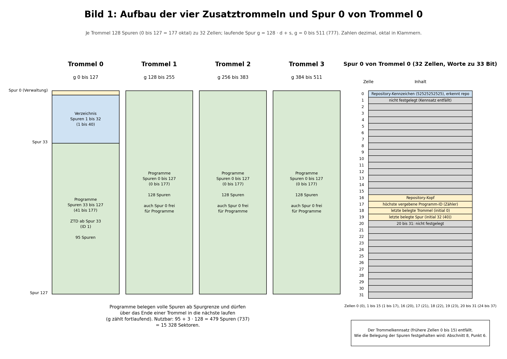
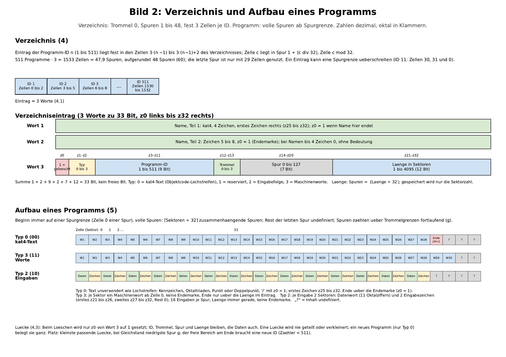
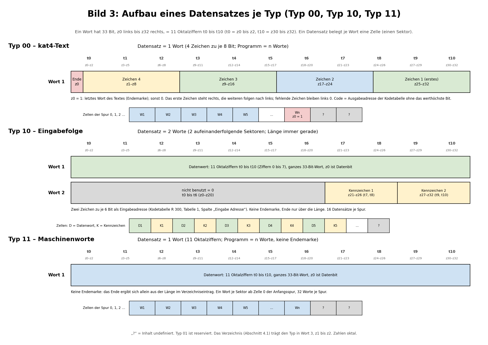

# ZT-Repository des C 8205Z

Version: 0.01-064

Experimenteller Prototyp C8205Z, nicht Teil des C-8205-Simulators. **Dieses eine Dokument beschreibt alles zum ZT-Repository**: wie das Repository auf den vier Zusatztrommeln (ZT) aufgebaut ist, was der Urlader (ZIL) tut, und die Bilder dazu. Kennzeichnung: **FEST** = festgelegt; **VORSCHLAG** = noch nicht festgelegt; **OFFEN** = Entscheidung fehlt.

- Der Aufbau in den Abschnitten 1 bis 8 (Projekt ZT-Loader: ZIL, ZTD, ZTL; Bilder in 3.2).
- Die Zusatztrommel selbst (Eckdaten, Befehle, Zeiten) steht in `Zusatztrommel_Zeitmodell.md`.

## 1. Vereinbarungen (FEST)

- Alle Zahlen sind oktal, auch in Dialogen und Anzeigen; Dezimal ist gekennzeichnet.
- Ein Wort ist ein Maschinenwort wie im Interpreter: 33 Bit, **z0 links bis z32 rechts**, z32 ist das niedrigstwertige Bit (Wert 1), z1 hat den Wert 2^31, z0 den Wert 2^32. Elf Oktalziffern schreiben ein Wort.
- Jede ZT hat **128 Spuren** (0 bis 127) zu **32 Zellen** (Sektoren 0 bis 37 oktal), je Zelle ein Wort. „Zelle“ und „Sektor“ sind dasselbe. Es gibt vier Trommeln, Nummer **0 bis 3**.
- **Laufende Spur** `g = 128 · d + s` für Spur s der Trommel d, also 0 bis 511 (dezimal).
- Befehle: `601` (Ausgabe) und `661` (Eingabe) übertragen immer **eine ganze Spur** zwischen Haupttrommel (HT) und gewählter ZT (Zeitmodell `Zusatztrommel_Zeitmodell.md`). Vorher wählt `5k00 030` (k = 1 bis 4) die Trommel an (gilt bis zur nächsten Anwahl): Trommel 0 = `5100 030`, Trommel 1 = `5200 030`, Trommel 2 = `5300 030`, Trommel 3 = `5400 030` (Korrektur des Inhabers 30.10.2026; früher stand hier irrtümlich 5000 bis 5300). Ohne Anwahl hält der Rechner mit Flag A (601) bzw. E (661).
- **Textformat `kat4`** wie im Assembler (Doku 3.3.14): 4 Zeichen je Wort zu je 8 Bit; das erste Zeichen steht **rechts** (z25 bis z32), die weiteren folgen nach links; z0 = 1 kennzeichnet das letzte Wort des Textes; fehlende Zeichen bleiben links 0. Als Code gilt die **Ausgabeadresse der Kodetabelle** (`C8205-Interpreter-Kodetabellen.md`, 1.4) ohne das werthöchste Bit. `kat4` gilt weiter für die Ausschriften des Urladers und für den Programmtext vom Typ 00 (Abschnitt 5).
- **Textformat `kat5`** (nur der **Programmname** im Verzeichnis; FEST, Inhaber 09.11.2026) wie im Assembler (Doku 3.3.15, seit c82ass 1.03-001): genau **ein Wort**, 1 bis 5 Zeichen, linksbündig: Zeichen 1 in z3 bis z8, Zeichen 2 in z9 bis z14, Zeichen 3 in z15 bis z20, Zeichen 4 in z21 bis z26, Zeichen 5 in z27 bis z32; z0 bis z2 immer 0; Füllung 00 rechts; **keine Endemarke**. Die Codes stehen in Sortierreihenfolge: 00 Füllung, 01 Leerzeichen, 02 bis 06 `, - . + = :`, 07 bis 020 Ziffern 0 bis 9, 021 bis 052 Buchstaben a bis z, 053 bis 055 Marken. Beispiel `ztd` = z 052, t 044, d 024 = **05244240000** (Gegenprobe der Formel: `abc` = 02122230000).

## 2. Zusammenhang der Programme

- Der **Urlader** ist ein **eigenständiges Programm** (standalone). Er wird vom Bediener als BIS-Objektcode auf eine beliebige Adresse geladen und gestartet: Der Bediener tippt über die Kennzeicheneingabe des Minimalprogramms `k1k2 = 10 aaaa 000` ein (aaaa = Startadresse des Urladers). Den Streifen liest er von Leser 1 (Abschnitt 6, Leserwahl). Er liegt nicht auf der ZT, hat keine ID und keinen Loader-Kern.
- Das **Dialogprogramm ZTD** wird vom Urlader als **Programm 1** ins Repository geladen (Abschnitt 6) und liegt damit auf der ZT.
- Weitere Programme im Repository sind die Nutzprogramme.
- **Dieses Dokument legt nur den Urlader und den Repository-Aufbau fest.** Was ZTD oder ein anderes Programm später mit dem Repository tut (Ablegen, Löschen, Auflisten, Typ 11, Dialogmeldungen), wird getrennt beschrieben.
- **Prototyp des Urladers:** `Assembler/Projekt_ZT_LOADER/Unterprojekt_ZIL_Initialloader/zil/zil.asm` setzt den Ablauf des Flussdiagramms (Abschnitt 6) um; `jneingabe`, `ztinit` (Makro `ZTINIT`), `pname` (Makro `PNAME`), `neuanl` (Makro `NEUANL`) und `hschl` (Makro `HSCHL`, Abschnitt 6c; legt den Streifen seit 01.11.2026 als **Typ 10** ab und liest mit dem UP `eingabe` = Makro `TYP10EINGABE`, Abschnitt 7a) sind programmiert, `repo` ist ein Platzhalter, der nur seinen Namen meldet. Die Elemente 16 und 17 sind ebenfalls programmiert (1.11.2026, Freigabe Inhaber): Element 16 trägt die Länge in SPUF-PN ein und schreibt SPUF-PN mit `neuanl` (R1 = SPUF-PN, R2 = 0, R3 = 1) **zum zweiten Mal** auf ZT 0 Spur 1 und 2; Element 17 wählt ZT 0 an (`030 05100`) und gibt SPUF-00 mit Befehl `601` (Spur 0) auf Spur 0 von ZT 0 aus (der Zähler in Zelle 17 steht dort jetzt auf 1, die Zellen 18 und 19 werden nicht nachgeführt, Abschnitt 8 Punkt 4); beide Elemente geben nichts aus. Tests: `zil` (Ja-Weg bis „ZTD geladen“), `zil_nein`, `zil_keinrepo`, `zil_lsziffer` (Streifen mit den Ziffern 8 und 9: kein Fehler mehr, ZTD wird geladen) und `zil_lszulang` (2048 Eingaben: `hschl` springt auf den Fehlerausgang `fe_lang` des Hauptprogramms, dort Ausschrift und Halt; ohne 15a/15b/`lsfehl`); für `hschl` selbst die Tests `hschl`, `hschl_voll`, `hschl_rand`, `hschl_ziffer`, `hschl_leer` und `hschl_zulang` (`Assembler/Projekt_ZT_LOADER/Unterprojekt_Allgemein/`); Aufruf `Assembler/asm_und_test.sh Claude/Projekt_ZT_LOADER/Unterprojekt_ZIL_Initialloader/<name> <name>`.
- **Start des Prototyps in GRAFIK (Betriebshinweis, 01.11.2026):** Der Urlader spricht die Zusatztrommeln mit `5100 030` bis `5400 030` an (`ztinit`, `neuanl`, Element 17). Diese Anwahlbefehle kennt der Interpreter **nur mit dem Aufrufschalter `--C8205Z`** (`c8205_grafik.py --C8205Z`, Trommeldateien `Trommel/ZT/zt1.txt` bis `zt4.txt`). Ohne den Schalter bleibt der Lauf bei der ersten Anwahl stehen (Anwahlbefehl `a2 < 4` nicht definiert, Flag A); das HW-Check-Fenster zeigt dann `BR = 5100 030` und `E/A-Halt -> Fehler`. Das ist der Befund, wenn nach der Antwort `J` (Zusatztrommel löschen) der Lauf mit E/A-Fehler endet. Die Tests (`asm_und_test.sh`) starten den Interpreter selbst mit `--C8205Z`.
- **Quelltexte** liegen im Projekt `Assembler/Projekt_ZT_LOADER/`: gemeinsame Makrodatei `macro_zt_loader.macro` im Projektstamm, Programme je Ordner in `Unterprojekt_Allgemein` (gemeinsame Bausteine), `Unterprojekt_ZIL_Initialloader`, `Unterprojekt_ZTD_Dialogmodul` und `Unterprojekt_ZTL_Kernmodul`. Jedes Programm liegt genau zwei Ebenen unter dem Projektstamm und bindet die Makrodatei mit `;#MACRODATEI1=../../macro_zt_loader.macro` ein; Programmnamen bleiben im ganzen Zip eindeutig (Tests und Eingabedateien liegen flach nach Namen).

## 3. Spur 0 von Trommel 0

Nur auf Trommel 0 liegt Verwaltung; **Trommeln 1 bis 3 sind vollständig für Programme frei** (auch ihre Spur 0).

| Zelle | Inhalt | Bemerkung |
|---|---|---|
| 0 | **Repository-Kennzeichen** (FEST): das Merkmal, an dem `repo` ein Repository erkennt | festes Wort, oktal **52525252525** (Bitmuster 1010…1, 33 Bit; weder 0 noch lauter Einsen, entsteht also weder durch Löschen noch zufällig). Die Wahl des Wortes hat der Inhaber freigestellt (30.10.2026) |
| 1 bis 15 | **nicht festgelegt** | Der bisherige Trommelkennsatz `tksatz[0..15]` (Zellen 0 bis 15) **entfällt** (Inhaber, 30.10.2026); Folgen siehe Abschnitt 8 Punkt 6 |
| 16 | **Repository-Kopf** (bisher zugleich das Erkennungsmerkmal; das ist jetzt Zelle 0, Rolle von Zelle 16 OFFEN, Abschnitt 8 Punkt 6) | 0 = es gibt kein Repository; sonst die Spur (auf Trommel 0), auf der das Repository-Verzeichnis beginnt (Vorgabe 1) |
| 17 | **Höchste vergebene Programm-ID** (Zähler) | höchstens 511 |
| 18 | **Letzte belegte Trommel** | initial 0 |
| 19 | **Letzte belegte Spur** | initial 32 (dezimal; oktal 40) = Länge des größten Programmverzeichnisses in ganzen Spuren, fester Wert, von `ztinit` beim Anlegen von Spur 0 eingetragen |
| 20 bis 31 | nicht festgelegt | |

### 3.1 Lage der Bits im Kennsatz (ENTFÄLLT mit dem Kennsatz)

*Der Trommelkennsatz in den Zellen 0 bis 15 entfällt (Abschnitt 3, Abschnitt 8 Punkt 6); der folgende Text beschreibt den früheren Stand und ist nachzuführen. Bild 1 zeigt ihn nicht mehr.*

Die laufende Spur `g` liegt im Wort `tksatz[g div 32]` auf dem Bit mit dem Wert `2^(g mod 32)`, das ist **z(32 − g mod 32)**: Spur 0 auf z32, Spur 1 auf z31, Spur 31 auf z1; z0 bleibt ungenutzt. Das niedrigste Spur-Bit ist z32.

Beispiele (Spur 32 von Trommel 0 → `tksatz[1]` z32; Trommel 1, Spur 0 → `tksatz[4]` z32; Trommel 3, Spur 127 → `tksatz[15]` z1) zeigt Bild 1 (3.2).

### 3.2 Übersicht: Aufbau der Trommeln (Grafik)

Die drei Bilder veranschaulichen die Abschnitte 3 bis 5a: Bild 1 zeigt die vier Trommeln mit Verzeichnis und Programmbereich sowie Spur 0 von Trommel 0 mit den Zellen 0 (Repository-Kennzeichen), 16 bis 19 und den nicht festgelegten Zellen (ohne Kennsatz); Bild 2 zeigt das Verzeichnis (2 Zellen je ID, Aufbau des Eintrags) und den Aufbau eines Programms (Spuren, Sektoren, Inhalt je Typ); Bild 3 zeigt den **Aufbau eines Datensatzes je Typ** (Typ 00, Typ 10, Typ 11, Bitlage nach Abschnitt 5a). Zahlen in den Bildern dezimal, oktal in Klammern. Quellen: `grafik_quelle/zt_bild1.py` (Bild 1) und `grafik_quelle/zt_bild3.py` (Bild 3), Aufruf je `python3 zt_bildN.py`, matplotlib; Bild 2 liegt nur als Bilddatei vor. Das PDF dieses Dokuments entsteht aus der `.md` mit dem Layout-Script `md_layout.py` (im Ordner `C8205Z/zt`: `python3 md_layout.py`; reportlab; die Bilddateien liegen neben der `.md`); jedes Bild steht dort auf einer eigenen A4-Querseite.

**Stand der Bilder (09.11.2026):** Die Bilddateien und das PDF zeigen noch den Stand vor der Umstellung auf `kat5` (3 Zellen je ID, Verzeichnis Spuren 1 bis 48, erste Programmspur 49, Zelle 19 = 48). Maßgeblich ist der Text. Bild 1 wird aus `grafik_quelle/zt_bild1.py` neu erzeugt, Bild 3 aus `grafik_quelle/zt_bild3.py` (nur der Fußtext „Das Verzeichnis trägt den Typ in Wort 3“ war überholt, jetzt „Wort 2“), Bild 2 liegt nur als Bilddatei vor und ist vom Inhaber nachzuführen (Abschnitt 8 Punkt 3).

### 3.3 Globale Zelle KB/GB (FEST)

Für das **ganze Projekt** gibt es **eine globale Zelle** in den Arbeitsspuren (77xx): den **KB/GB-Umschalter** (Kleinbuchstaben/Großbuchstaben der Ein- und Ausgabe). Sie heißt im Flussdiagramm **KBGB**; Wert 0 = KB, 1 = GB. **Alle Hauptprogramme (HP) und Unterprogramme (UP) benutzen diese eine Zelle.** Das Hauptprogramm setzt sie **nach dem Start auf KB** (Ablaufpunkt 1a, Abschnitt 6).

- **Adresse (FEST, vom Inhaber am 30.10.2026 bestätigt):** Zelle **7775**. In den Arbeitsspuren sind sonst belegt: R1 = 7773, R3 = 7774, R2 = 7776 und 7777 als BIS-Transportzelle; 7775 ist sonst nirgends belegt.
- **Nachführen (FEST):** Ändert ein HP oder UP den KB/GB-Zustand (Um. KB, Um. GB), **führt es die globale Zelle nach**. Ein UP **muss** dafür das Unterprogramm `dtm` **nicht** verwenden; die Art der Ausgabe ist frei, nur die Zelle muss stimmen. Im Projekt gibt das Unterprogramm `ausgabe` (Projektmakro `KAT4AUSGABE_G` in `macro_zt_loader.macro`) einen `kat4`-Text aus: Es liest KBGB vor dem ersten Zeichen und führt sie bei jedem Umschaltzeichen im Text nach (Um. GB setzt 1, Um. KB setzt 0). Die Anweisung `kat4` fügt keine Umschaltzeichen ein; sie stehen **im Text** (im ZIL als Textwörter, erzeugt von `zil/gen/zil_texte.py`). Jeder Text ist so geschrieben, als stünde das Gerät bei seinem ersten Zeichen in KB; steht KBGB auf GB, gibt das Unterprogramm zuerst Um. KB aus.
- **Folge:** Die Übergabe des Zustands über ein Register (bisher R3 = 7774) und die lokale Zustandszelle im Hauptprogramm (bisher `kbein`, Zelle 0002) **entfallen** (Abschnitte 6 und 7a).

### 3.4 Zusammenhang: Spur 0, Verzeichnis, Programmcode und die drei Spurpuffer (Prüfung 31.10.2026)

Der Weg zu einem Programm führt über drei Stufen, jede mit einem Spurpuffer im Hauptprogramm (alle auf Spurgrenze, `equ40`):

| Stufe | Inhalt | Wo auf der ZT | Puffer | Größe |
|---|---|---|---|---|
| A. Repository (Spur 0) | Kennzeichen (Zelle 0), Repository-Kopf (16), Zähler = höchste vergebene ID (17), **letzte belegte Trommel (18) und letzte belegte Spur (19)** | Trommel 0, Spur 0 | SPUF-00 | 32 Zellen = 1 Spur |
| B. Programmverzeichnis | je ID 2 Zellen (4.1); Eintrag der ID n ab Zelle 2 · (n − 1) | Trommel 0, **Spuren 1 bis 32** | SPUF-PN | 64 Zellen = 2 Spuren = ID 1 bis 32 vollständig (6b) |
| C. Programmcode | die Datensätze des Programms (5a) | ab Trommel und Spur aus Wort 2 des Eintrags | Programmcode-Puffer | 32 Zellen = 1 Spur (FEST, Inhaber 31.10.2026); `zil.asm` (`spufpc`, 32 Zellen) und der Graph sind angepasst |

- **A:** Die Zellen 18 und 19 nennen die **letzte belegte** Spur, nicht den nächsten freien Sektor. Der freie Platz für neuen Programmcode ist die **Spur nach der Spur in Zelle 19** (bei Spur 127 die Spur 0 der Trommel Zelle 18 + 1), dort **Zelle 0**, denn ein Programm beginnt immer auf einer Spurgrenze (5). Vom Anlegen an steht dort Trommel 0, Spur 32, also ist der erste freie Platz Spur 33 (ZTD). Das Nachführen der Zellen 18 und 19 nach dem Laden eines Programms ist noch nicht festgelegt (Abschnitt 8 Punkt 4).
- **B:** Das Verzeichnis liegt in den **Spuren 1 bis 32** (nicht bis 33; Spur 33 ist die erste Programmspur). Je Programm 2 Zellen, also **16 Einträge je Spur**; ein Eintrag liegt immer ganz in einer Spur (2 Zellen, 32 ist gerade) und überschreitet nie eine Spurgrenze (mit 3 Zellen je Eintrag war das bis 09.11.2026 anders). Der Eintrag wird (a) **direkt über die ID** gefunden (Zelle 2 · (ID − 1); ID 1 liegt in Spur 1, Zellen 0 und 1) oder (b) **über den Namen**, indem das Namenswort (Wort 1) der Einträge 1 bis Zähler verglichen wird (ein Wort statt zwei); gelöschte Einträge (z0 von Wort 2 = 1) und leere Namen (Wort 1 = 0) zählen dabei nicht. Die Suche über alle bis zu 511 Einträge braucht die Spuren 1 bis 32 nacheinander (in Schritten zu 2 Spuren 16 Lesevorgänge); SPUF-PN fasst nur 2 Spuren.
- **C:** Die Programmcode-Sektoren liegen ab **Trommel (Wort 2, z12 bis z13) und Spur (z14 bis z20)**, Zelle 0 der Spur; **Länge in Sektoren** (z21 bis z32), Spurzahl = ⌈Länge ÷ 32⌉; ein Programm darf über das Ende einer Trommel in die nächste laufen (g zählt fortlaufend). Ein Puffer von 32 Zellen (1 Spur) fasst 32 Datensätze von Typ 00 oder Typ 11 (je 1 Wort) und **16 Datensätze von Typ 10 (je 2 Worte)**; „16 Einträge zu 2 Worten“ gilt also nur für Typ 10.

## 4. Repository-Verzeichnis (FEST)

- **Lage:** auf Trommel 0, **zusammenhängend aus ganzen Spuren**, **fest ab Spur 1**, also Spuren 1 bis 32. Eine andere Lage ist nicht vorgesehen.
- **Größe:** für jedes mögliche Programm 2 Zellen, bei 511 Programmen 1022 Zellen = 31,94 Spuren, **aufgerundet 32 Spuren**. Die letzte Spur ist nur mit 30 Zellen genutzt (1022 − 31 · 32).
- **Immer reserviert:** Die 32 Spuren sind belegt (im Kennsatz gesetzt), auch wenn kaum ein Programm eingetragen ist.
- **Fester Platz:** Der Eintrag mit der Programm-ID `n` (1 bis 511) liegt **immer an derselben Stelle**: Zellen `2·(n−1)` und `2·(n−1)+1` des Verzeichnisses (Spur `1 + ⌊(n−1) ÷ 16⌋`, Zelle `2 · ((n−1) mod 16)`; ID 1: Spur 1, Zellen 0 und 1; ID 32: Spur 2, Zellen 62 und 63; ID 511: Spur 32, Zellen 28 und 29). Das Verzeichnis ist fortlaufende Rohdaten; die Zelle `c` des Verzeichnisses liegt in Spur `1 + (c div 32)`, Zelle `c mod 32`. Ein Eintrag überschreitet dabei nie eine Spurgrenze (ID 16: Zellen 30 und 31 der ersten Spur, ID 17: Zellen 0 und 1 der zweiten).

### 4.1 Verzeichniseintrag (2 Worte)

| Wort | Bits | Inhalt |
|---|---|---|
| 1 | z0 bis z32 | **Name**, `kat5`, genau 1 Wort, 1 bis 5 Zeichen (4.4) |
| 2 | z0 | **1 = Programm gelöscht** (Lücke) |
| 2 | z1 bis z2 | **Typ** 0 bis 3 (siehe unten) |
| 2 | z3 bis z11 | **Programm-ID** 1 bis 511, binär, 9 Bit |
| 2 | z12 bis z13 | **Trommelnummer** 0 bis 3, auf der das Programm beginnt |
| 2 | z14 bis z20 | **Spurnummer in der Trommel** 0 bis 127, 7 Bit, voll genutzt |
| 2 | z21 bis z32 | **Länge in Sektoren** 1 bis 4095 (12 Bit), siehe unten |

Die Summe der Felder in Wort 2 ergibt 1 + 2 + 9 + 2 + 7 + 12 = 33 Bit. Es gibt kein freies Bit mehr. Bis 09.11.2026 hatte der Eintrag 3 Worte (Name `kat4` in Wort 1 und 2, die Felder in Wort 3); die Bitlage der Felder ist unverändert, nur die Wortnummer ist jetzt 2.

**Typ (z1, z2):**

| Typ | Wert | Inhalt des Programms |
|---|---|---|
| 00 | 0 | `kat4`-Text (Objektcode-Lochstreifen des BIS, Abschnitt 5); Datensatz = 1 Wort, z0 = 1 im letzten Wort (5a) |
| 01 | 1 | reserviert für einen späteren Datentyp |
| 10 | 2 | Eingabefolge: Datensatz = 2 Worte (Datenwort, Wort mit zwei Kennzeichen), keine Endemarke (Abschnitt 5, 5a) |
| 11 | 3 | Folge von Maschinenworten (33 Bit je Sektor), elf Oktalziffern je Wort; **keine Endemarke**, z0 ist Datenbit (5a) |

**Länge (FEST):** Das Feld gibt die **Zahl der Sektoren an, die dem Eintrag zugeordnet sind**. Die Zahl der Spuren wird nie gespeichert, sie ergibt sich als `⌈Länge ÷ 32⌉`. Länge 0 gibt es nicht. Die Länge bedeutet:

- **Programm neu im freien Bereich am Ende:** die **echte belegte Sektorzahl**, vom Urlader oder Dialog gezählt.
- **Programm in einer wiederbelegten Lücke:** die **Größe der Lücke**; sie bleibt dauerhaft unverändert (4.3). Die echte Länge des Programms findet man bei Typ 00 über die Endemarke (z0 = 1 im letzten `kat4`-Wort).
- Bei **Typ 10** gibt es keine Endemarke; die Länge ist die echte Sektorzahl, also **2 mal die Zahl der Eingaben** (immer gerade). Ein Typ-10-Programm steht wie Typ 11 nur im freien Bereich am Ende (VORSCHLAG).
- Bei **Typ 11** gibt es keine Endemarke. Ein Typ-11-Programm steht nur im freien Bereich am Ende, dort ist die Länge die echte Wortzahl.
- Die **echte Länge** wird beim Einlesen der Daten ermittelt (Typ 00 über die Endemarke, Typ 10 und Typ 11 aus dem Eintrag); das Auflisten zeigt nur den Wert aus dem Eintrag.

### 4.2 Programm-ID (FEST)

- Wort 17 ist der **Zähler**; er zeigt auf die zuletzt vergebene ID.
- Ein Programm **im freien Bereich am Ende** bekommt `Wort 17 + 1`, und Wort 17 wird erhöht. Das geht nur, solange Wort 17 kleiner als 511 ist. Bei 511 gibt es keine neue ID mehr; das freie Ende ist dann **für kein Programm mehr nutzbar**, nur noch Lücken.
- Ein Programm **in einer Lücke** bekommt **die ID der Lücke** (den gelöschten Eintrag, dessen Lücke es belegt). Wort 17 ändert sich dabei nicht. Es wird kein Verzeichnis nach IDs durchsucht.
- Jede ID bis zum Stand des Zählers hat einen Eintrag, der entweder ein Programm oder eine Lücke ist.
- **ID 1 ist das Dialogprogramm ZTD**, vom Urlader vergeben. Das erste Nutzprogramm bekommt die ID 2.
- Die ID hat **nur innerhalb des Zusatztrommel-Laders** Bedeutung: Sie ist die Kurznummer, mit der man ein Programm nennt, ohne jedes Mal den Namen zu übergeben.
- Die Größe der ID (9 Bit) hat nichts mit der Programmgröße zu tun.

### 4.3 Gelöschter Eintrag und Lücke (FEST)

- Beim Löschen wird in Wort 2 nur **z0 auf 1** gesetzt. ID, Trommel, Spur und Länge bleiben **dauerhaft unverändert**; die **Daten werden nicht angerührt**. Die Spuren werden im Kennsatz frei.
- Der gelöschte Eintrag beschreibt die **Lücke**: Anfang `g = 128 · Trommel + Spur`, Größe `⌈Länge ÷ 32⌉` Spuren. Die Daten in der Lücke sind die letzte, nur logisch gelöschte Belegung; sie entspricht dem Maximum, das in diese Lücke passt.
- Eine Lücke wird **nie geteilt und nie verkleinert**. Ein neues Programm belegt sie **als Ganzes**, auch wenn es kleiner ist; im Kennsatz werden wieder alle Spuren der Lücke gesetzt.
- **Zur Wiederbelegung ist nur Typ 00 zulässig**, nie Typ 11 (auch nicht bei genau passender Größe). Seine Endemarke zeigt in den Daten das Programmende, die Lückengröße steht in der unveränderten Länge. Beim Wiederbelegen ändern sich nur Name, Typ (00) und z0 (auf 0); ID, Trommel, Spur und Länge bleiben.
- Zum Schreiben genügen die Spuren bis zur Endemarke. Der Inhalt dahinter ist ein Rest der früheren Belegung und **undefiniert**.
- Erst eine Verdichtung könnte Spur und Länge eines Eintrags ändern. Eine Verdichtung ist nicht vorgesehen.

### 4.4 Name (FEST)

- Das Namensfeld ist immer **1 Wort** (Wort 1 des Eintrags), `kat5` (Abschnitt 1): 1 bis 5 Zeichen, linksbündig, ohne Endemarke (Festlegung Inhaber 09.11.2026; bis dahin 2 Worte `kat4`, 8 Zeichen).
- **Länge des Namens:** 1 bis 5 Zeichen. Ein leerer Name (Wort 0) ist unzulässig und kennzeichnet einen unbenutzten Eintrag; ein gültiger Name ist immer ungleich 0, denn das erste Zeichen hat mindestens den Code 01.
- **Zulässige Zeichen (Annahme nach dem Vorschlag der Aufgabenstellung, vom Inhaber noch nicht bestätigt; Abschnitt 8 Punkt 3):** nur Kleinbuchstaben und Ziffern; `_` entfällt, weil `kat5` es nicht kennt. Jedes Zeichen der Menge ist an jeder Stelle erlaubt, auch das erste. Leerzeichen und `, - . + = :` gibt es in `kat5`, sie sind für Namen nicht vorgesehen; die Marken (053 bis 055) sind ausgeschlossen.
- **Doppelte Namen sind unzulässig** und werden schon bei der Namenseingabe abgewiesen; verglichen wird ein Wort. Gelöschte Einträge haben logisch keinen Namen mehr und zählen bei der Prüfung nicht mit.
- **Beispiel `ztd`:** Wort 1 trägt `z` (052) in z3 bis z8, `t` (044) in z9 bis z14, `d` (024) in z15 bis z20, z21 bis z32 sind 0 (Füllung), z0 bis z2 sind 0: **05244240000**. Die Codes sind die der `kat5`-Tabelle der Assemblerdokumentation 3.3.15.

## 5. Programme auf den Trommeln (FEST)

- **Typ 00, Format `kat4`:** Das Programm wird **unverändert** so gespeichert, wie es als Objektcode-Lochstreifen des BIS erzeugt wurde: die zwei Kennzeichen, die folgenden Oktaltriaden und der abschließende Punkt oder Doppelpunkt, Wort für Wort, als **`kat4`-Text** (Abschnitt 1). Das erste Zeichen des Programms steht im ersten Wort ab der Anfangsspur in z25 bis z32. Beim Lochstreifenende `/` wird `/` mitgespeichert und im betreffenden `kat4`-Wort **z0** gesetzt.
- **Typ 11, Maschinenworte (FEST):** Das Programm ist eine **Folge von n Maschinenworten zu je 11 Oktalziffern**, ein Wort je Sektor, ab Zelle 0 der Anfangsspur. Es gibt keine Kennzeichen, keinen Punkt oder Doppelpunkt und **keine Endemarke**; z0 ist ein normales Datenbit. Das Ende ergibt sich allein aus der Länge im Eintrag. Eine Spur fasst 32 Worte. Aufbau des Datensatzes: 5a.
- **Typ 10, Eingabefolge (FEST):** Das Programm ist eine Folge von **Eingaben**; jede Eingabe belegt immer **2 aufeinanderfolgende Sektoren** (Zellen), beginnend ab Zelle 0 der Anfangsspur. Es gibt keine Endemarke; das Ende ergibt sich allein aus der Länge im Eintrag (4.1), die gerade ist. Eine Spur fasst 16 Eingaben.
  - **1. Zelle, Datenwert:** ein vollständiges Maschinenwort, geschrieben als **11 Oktalziffern**. In der Eingabe kommen dafür nur die Zeichen 0 bis 7 vor (Oktalziffern), das Wort wird als gewöhnliches 33-Bit-Wort abgelegt (z0 ist ein Datenbit).
  - **2. Zelle, Kennzeichen 1 und 2:** als **Eingabeadressen der Kodetabelle R 300** (Tabelle 1 in `C8205-Interpreter-Kodetabellen.md`, Spalte „Eingabe Adresse“; in der Aufgabe als „r200-code“ bezeichnet, in diesem Projekt ist die Tabelle R 300 gemeint, Annahme). **Zulässige Zeichen nur: 0 bis 9, B, D, +, `.` und `:`**; ihre Eingabeadressen (oktal): 0 bis 9 = 00 bis 11, `+` = 20, B = 22, D = 24, `:` = 15, `.` = 33 (Tabelle gegenzuprüfen). Jedes andere Zeichen wird abgewiesen.
  - **Bitlage der 2. Zelle (FEST, Inhaber 31.10.2026; Eingabe siehe 7a):** zwei Zeichen zu je 6 Bit (zwei Oktalziffern, Eingabeadresse 00 bis 77): **Kennzeichen 1 (erstes Zeichen) in z21 bis z26 (t7 und t8), Kennzeichen 2 (zweites Zeichen) in z27 bis z32 (t9 und t10)**; t0 bis t6 (z0 bis z20) = 0.
  - **Bedeutung der beiden Zeichen:** legt das auswertende Programm fest, nicht dieses Dokument.
- **Länge:** Bedeutung siehe 4.1. Bei einem neuen Programm im freien Bereich zählt der Lader die benutzten Sektoren und trägt sie ein.
- **Lage:** Ein Programm beginnt immer auf einer **Spurgrenze** (Zelle 0 einer Spur) und belegt **volle Spuren**: `⌈Sektoren ÷ 32⌉` zusammenhängende Spuren. Der Rest der letzten Spur bleibt ungenutzt, sein **Inhalt ist undefiniert**. Es darf **über das Ende einer Trommel hinweg** in die nächste laufen; die Spuren zählen dann fortlaufend mit `g`.
- **Belegung:** Beim Aufbau des Repositorys werden die Programme **nacheinander lückenlos** geschrieben (freier Bereich am Ende), das erste ist ZTD ab Spur 33. Gelöschte Programme werden zu Lücken (4.3).
- **Wahl des Platzes für ein neues Programm:**
  - Ein Programm vom **Typ 00** kann in eine Lücke oder in den freien Bereich am Ende. Gewählt wird die **kleinste Lücke, in die es passt** (seine Spurzahl ≤ Spurzahl der Lücke). Bei gleich großen Lücken gilt die mit der niedrigsten laufenden Spur `g`. Der freie Bereich am Ende gilt ebenfalls als Lücke, er braucht aber eine neue ID (Wort 17 < 511).
  - Ein Programm vom **Typ 11** oder **Typ 10** kommt nur in den freien Bereich am Ende (Typ 10 VORSCHLAG).
- **Keine Verdichtung:** Programme werden nicht zusammengeschoben. Es kann Platz fehlen, obwohl insgesamt genug Spuren frei sind, wenn sie nicht zusammenhängen (dann Meldung „Platz reicht nicht“).
- **Lücke über Trommelgrenzen:** Eine Lücke darf über das Ende einer Trommel hinweg in die nächste reichen und gilt als eine Lücke, weil `g` fortlaufend zählt.
- **Nutzbarer Raum:** Trommel 0 hat nach Spur 0 und dem Verzeichnis (Spuren 1 bis 32) die Spuren 33 bis 127 (95 Spuren); Trommeln 1 bis 3 haben je 128 Spuren. Zusammen 479 Spuren = 15 328 Sektoren (dezimal), darin ZTD.
- **Höchstzahl der Programme:** `⌊479 ÷ ⌈Länge ÷ 32⌉⌋`, höchstens 479, wenn jedes Programm in eine Spur passt; ZTD zählt mit.

## 5a. Aufbau eines Datensatzes je Typ (FEST bis auf die Punkte unter „Offen“, Inhaber 31.10.2026)

Dieser Abschnitt fasst den Aufbau der Datensätze der drei Programmtypen in einer Stelle zusammen; Bild 3 (3.2) zeigt ihn mit den Bitlagen. Ein Wort hat 33 Bit (z0 links bis z32 rechts) und entspricht den **11 Oktalziffern t0 bis t10** (t0 = z0 bis z2, t1 = z3 bis z5, …, t10 = z30 bis z32). Jedes Wort steht in einer Zelle (einem Sektor). Das Programm ist eine Folge von Datensätzen ab Zelle 0 der Anfangsspur (5).

| Typ | Datensatz | Worte je Datensatz | Ende des Programms |
|---|---|---|---|
| 00 | `kat4`-Text | 1 | z0 = 1 im letzten Wort |
| 10 | Eingabe (Datenwert und Kennzeichen) | 2 | nur über die Länge im Eintrag (gerade) |
| 11 | Maschinenwort | 1 | nur über die Länge im Eintrag (keine Endemarke) |

**Typ 00 – ein Datensatz = 1 Wort:**

| Bits | Inhalt |
|---|---|
| z0 | 1 = letztes Wort des Textes (Endemarke), sonst 0 |
| z25 bis z32 | Zeichen 1 (das erste, rechts) |
| z17 bis z24 | Zeichen 2 |
| z9 bis z16 | Zeichen 3 |
| z1 bis z8 | Zeichen 4 |

Code der Zeichen: Ausgabeadresse der Kodetabelle ohne das werthöchste Bit (Abschnitt 1); fehlende Zeichen bleiben links 0. Ein Programm von n Worten fasst 4 · n Zeichen.

**Typ 10 – ein Datensatz = 2 Worte (2 aufeinanderfolgende Zellen):**

| Wort | Bits | Inhalt |
|---|---|---|
| 1 | t0 bis t10 (z0 bis z32) | **Datenwert**: 11 Oktalziffern (nur 0 bis 7), ganzes 33-Bit-Wort, z0 ist Datenbit |
| 2 | t0 bis t6 (z0 bis z20) | nicht benutzt, 0 |
| 2 | **t7 und t8 (z21 bis z26)** | **Kennzeichen 1** (erstes Zeichen), gespeichert als Eingabeadresse (6 Bit) gemäß Spalte „Eingabe Adresse“ der Kodetabelle (R 300) |
| 2 | **t9 und t10 (z27 bis z32)** | **Kennzeichen 2** (zweites Zeichen), ebenso |

Keine Endemarke; Länge im Eintrag = 2 · Zahl der Datensätze (gerade). Eine Spur fasst 16 Datensätze. Die Bedeutung der beiden Kennzeichen legt das auswertende Programm fest.

**Typ 11 – ein Datensatz = 1 Wort, ein Programm = n Worte:**

| Bits | Inhalt |
|---|---|
| z0 bis z32 | **Datenwort**: 11 Oktalziffern t0 bis t10, ganzes 33-Bit-Wort, z0 ist Datenbit |

Keine Endemarke; das Ende ergibt sich allein aus der Länge im Eintrag (= Zahl der Worte). Eine Spur fasst 32 Worte.

## 6. Der Urlader (FEST)

Der Urlader ist eigenständig (Abschnitt 2). Sein Ablauf ist als Flussdiagramm gezeichnet (`Assembler/Projekt_ZT_LOADER/Unterprojekt_ZIL_Initialloader/zil/ablauf/ZIL_Ablauf.pdf`, Seite 1 Hauptprogramm `haupt`, Seite 2 Unterprogramm `jneingabe`, Seite 3 Unterprogramm `ztinit`, Abschnitt 6a, Seite 4 Unterprogramm `hschl`, Abschnitt 6c; die Nummern 44 bis 66 der Seite 4 setzen die der Seite 3 fort); die laufenden Nummern stehen in Klammern. Die Parameter jedes Unterprogramms (Ein, Aus, Wirkung) stehen im Diagramm in einem gestrichelt angekoppelten Kästchen rechts neben dem blauen Unterprogramm-Element. Alle Ausschriften gehen über K2 (Schreibwerk) auf eine eigene Zeile, im Prototyp über das Makro `MELDUNG` (K2 anwählen, Text über das Unterprogramm `ausgabe` = `KAT4AUSGABE_G`, Zeilenschaltung). Folge für die Eingabe: Die Frage „Zusatztrommel loeschen [J/N]“ endet in GB (KBGB = 1); wer danach ein kleines j oder n eingeben will, sendet zuerst Um. KB.

**Ablauf (FEST):**

**Initialisierung KB (1a):** Unmittelbar nach dem Start setzt das Hauptprogramm die globale Zelle KBGB (Abschnitt 3.3) auf **KB** (0). Danach gilt sie für alle Unterprogramme; wer KB/GB ändert, führt sie nach. Der Punkt trägt im Flussdiagramm die feste Nummer 1a, die übrigen Nummern bleiben unverändert.

1. **Repository prüfen** (2, 3): Unterprogramm `repo` liest Spur 0 von ZT 0 in den Spurpuffer SPUF-00 (R1 = Adresse des Puffers) und prüft das **Repository-Kennzeichen** (Zelle 0): ungleich 52525252525 = kein Repository. Es liefert R2 = 1 (Repository vorhanden) oder 0 (keines). Bei 0: Ausschrift „Kein Repository gefunden“ (19), dann Ende (20, 21). Der Urlader bietet in diesem Fall nichts an. 
2. **Frage** (4, 5, 6): Ausschriften „Repository gefunden“ und „Zusatztrommel loeschen [J/N]“; die Antwort liest das Unterprogramm `jneingabe` über K0 (SW-Eingabe). Es zählt **nur der Großbuchstabe J oder N**; jedes andere Zeichen wird übergangen, denn das Löschen ist zerstörend. R2 = 1 bei J, 0 bei N.
3. **Antwort N** (7, 8, 9): Ausschrift „Programmende“, dann Ende. Der Urlader hat nichts verändert.
4. **Antwort J** (10): Unterprogramm `ztinit` (R1 = Adresse SPUF-00, Spezifikation in Abschnitt 6a) **löscht alle vier Trommeln auf 0** (4 · 128 Spuren; bei etwa 85 ms je Spur rund 44 s) und **legt Spur 0 von Trommel 0 an**: Repository-Kennzeichen (Zelle 0) = 52525252525 oktal (der bisherige Kennsatz in den Zellen 0 bis 15 entfällt), Repository-Kopf (Zelle 16) = 1, Zähler (Zelle 17) = 0, letzte belegte Trommel (Zelle 18) = 0, letzte belegte Spur (Zelle 19) = 32 (dezimal; oktal 40). Das **Verzeichnis** (Spuren 1 bis 32) ist leer (nur Nullen, vom Löschen).
5. **Spurpuffer „Namensverzeichnis“ (SPUF-PN) vorbereiten** (11a): Das Hauptprogramm legt den Bereich für SPUF-PN **auf eine Spurgrenze** und **löscht** ihn (alle Wörter 0 = leere Einträge). **SPUF-PN ist ein 2-Spur-Puffer** (64 Zellen, Verzeichnisspuren 1 und 2 von ZT 0; Festlegung Inhaber 30.10.2026). **Auch der Spurpuffer „Programmcode“ (1 Spur) liegt auf einer Spurgrenze** (FEST, 30.10.2026); SPUF-00 ebenfalls (6a). Den Spurpuffer von Spur 0 von ZT 0 nennt das Dokument SPUF-00.
6. **Programmname eintragen** (13): **allgemeines Unterprogramm** (Festlegung 30.10.2026: später nachnutzbar, als **Projektmakro** `PNAME` in `macro_zt_loader.macro`, programmiert und getestet 30.10.2026; Spezifikation in Abschnitt 6b). Parameter nach dem Graphen: **R1 = Adresse SPUF-PN, R2 = Adresse der Namenszelle (`kat5`-Name, eine Zelle), R3 = Adresse SPUF-00**. Es ermittelt die Lage des Eintrags aus SPUF-00 und trägt den **festen Namen `ztd`** (`kat5`, Abschnitt 4.4, Wort 1) sowie in Wort 2 die Felder **Typ 10, ID, Trommel und Spur** ein. Rückgabe: keine.
7. **Neuanlage Programm** (14, Festlegung Inhaber 30.10.2026): Unterprogramm, das **SPUF-PN (den Programmnamen-Puffer, 2 Spuren) auf die Zusatztrommel schreibt**. Es **bekommt Trommelnummer und Spurnummer als Übergabe** (Spur und Trommel der ersten der beiden Spuren; die zweite Spur ist die folgende). Für das Verzeichnis: Trommel 0, Spur 1 und 2. **Parameter (programmiert 30.10.2026 als Projektmakro `NEUANL`; die Zuordnung hat der Inhaber noch nicht ausdrücklich bestätigt): R1 = Adresse SPUF-PN (Adressfeld), R2 = Trommelnummer 0 bis 3, R3 = Spurnummer der ersten Spur (R2 und R3 sind Zahlen, nicht Adressfeld; kein Register wird verändert)**; Rückgabe keine, keine Ausschrift, KBGB unberührt, die Trommel R2 bleibt angewählt. Wirkung: Anwahl der Trommel (`5k00 030`, k = Trommelnummer + 1), dann SPUF-PN Zellen 0 bis 31 auf Spur R3 und Zellen 32 bis 63 auf Spur R3 + 1 ausgeben (Befehlswort `s · 2^26 + Adresse + 601`, Spurfeld durch Schieben, Adresse der zweiten Hälfte = R1 + 32 Zellen). Im Prototyp ruft das Hauptprogramm mit R1 = SPUF-PN, R2 = 0, R3 = 1 auf (Verzeichnis: Trommel 0, Spuren 1 und 2). **Reihenfolge im Ablauf (FEST):** 14 steht **vor** der Länge, also schreibt es SPUF-PN mit **Länge 0**; **nach Element 16 schreibt das Hauptprogramm SPUF-PN noch einmal** (zweites Schreiben, jetzt mit der Länge; Punkt 11). SPUF-PN wird also zweimal geschrieben. Das erste Schreiben ist ohne Wirkung für das Repository, solange Spur 0 noch den Zähler 0 trägt (Schreibreihenfolge unten). Die frühere Parameterfassung (R1 = Programm-ID 01, R2 = Adresse SPUF-00) **entfällt**; den Zähler führt Element 13 (Abschnitt 6b).
8. **Aufforderung** (12): Ausschrift „Lochband mit ZTD in Leser 1 einlegen“ (Makro `MELDUNG`: K2 anwählen, Text, WRZL; WRZL wählt danach K0 an).
9. **K1 anwählen** (14a): Das Hauptprogramm wählt **nach** der Aufforderung K1 (Lochbandleser 1) an (`4600 030`); K1 bleibt bis zum Lesen in Element 15 angewählt (Festlegung Inhaber 30.10.2026: 12 und 14a vertauscht, weil `MELDUNG` den Kanal sonst auf K0 stellt).
10. **Lochstreifen laden** (15): Unterprogramm „Hauptschleife Ls nach ZT“ mit R1 = Adresse des Spurpuffers „Programmcode“ (1 Spur = 32 Zellen), **R2 = Trommelnummer und R3 = Spurnummer der ersten Zielspur (Zahlen; wie bei `NEUANL`)**; für ZTD übergibt das Hauptprogramm Trommel 0 und Spur 33 (Spur nach der letzten belegten, Zelle 19 = 32). R1 und R3 bleiben unverändert. Es liest den **BIS-Objektcode-Lochstreifen des Dialogprogramms ZTD** von Leser 1 und speichert ihn **als Typ 10** (**FEST, Inhaber 01.11.2026**; früher fälschlich im `kat4`-Format): jede Eingabe des Streifens (zwei Kennzeichen, Ziffern, `.` oder `:`, Abschnitt 7a) wird mit dem Makro `TYP10EINGABE` gelesen und ergibt **2 aufeinanderfolgende Zellen** (Wort 1 = Datenwert, Wort 2 = Kennzeichen), ab der übergebenen Spur (ZTD: Spur 33), Zelle 0; 16 Eingaben je Spur. Das Lochstreifenende `/` beendet den Streifen und wird **nicht** gespeichert. Rückgabe: R2 = **echte Sektorzahl** (= 2 · Zahl der Eingaben, gerade). R1, R3 und KBGB bleiben unverändert. **Fehler im Lochstreifen** (mehr als 4095 Sektoren = 2048 Eingaben; die Ziffern 8 und 9 sind kein Fehler mehr) behandelt das Unterprogramm **selbst**: es gibt die Meldung **immer als Ausschrift auf dem SW** aus (Tabelle unten) und hält an (umgesetzt als Sprung auf den Fehlerausgang `fe_lang` des Hauptprogramms, der dem Makro als Parameter übergeben wird, Abschnitt 6c). Es gibt **keine Fehlerrückgabe** (Vorgabe Inhaber 31.10.2026); das Hauptprogramm setzt nie fort, Verzeichnis und Spur 0 werden dann nicht geschrieben (16 und 17 stehen hinter dem Aufruf). Die früheren Elemente 15a (Verzweigung) und 15b (Ausschrift) im Hauptprogramm entfallen.
11. **Verzeichnis und Spur 0 schreiben** (16, 17): Die Sektorzahl wird als Länge (**nur Bitfeld z21 bis z32 von Wort 2**) in SPUF-PN eingetragen, SPUF-PN (2 Spuren) **zum zweiten Mal** auf ZT geschrieben (Verzeichnisspuren 1 und 2; das erste Mal in Element 14 mit Länge 0), danach Spur 0 von ZT 0 aus SPUF-00 (Schreibreihenfolge unten). **Umgesetzt im Prototyp `zil.asm` (1.11.2026):** Element 16 ruft `neuanl` ein zweites Mal mit R1 = SPUF-PN, R2 = 0, R3 = 1 auf; Element 17 besteht aus der Anwahl `030 05100` (ZT 0) und der Ausgabe `601 spuf00` (zzz0 = 0000, Spur 0); keine Ausschrift. Test `zil` (seit 09.11.2026, `kat5`): ZT 0 Zelle 0040 = 05244240000 (Name `ztd`), Zelle 0041 = 20010410006 (Länge 6) und Zelle 0021 = 1 (Zähler).
12. **Meldung und Ende** (18, 21): Ausschrift „ZTD geladen mit Programm-ID 1“.

**Eintrag von ZTD (Wort 1: Name `ztd` = `05244240000`; Wort 2):** Typ 10, nicht gelöscht, ID 1, Trommel 0, Spur 33 (dezimal, oktal 41): `20010410000` + Länge (oktal, bis 7777, ohne Übertrag); bis 09.11.2026 Spur 49 und `20010610000` + Länge.

**Schreibreihenfolge (FEST):** Die Länge ist erst bei `/` bekannt. Der Urlader schreibt die Streifenspuren laufend, sobald je 32 Worte voll sind, die letzte teilvolle Spur bei `/`. Schon vorher, nach dem Eintragen des Namens (Element 14), hat er die Verzeichnisspuren 1 und 2 (SPUF-PN) mit Länge 0 geschrieben. Nach dem `/` schreibt er sie **noch einmal** mit dem vollständigen Eintrag (Länge) und zuletzt Spur 0 neu, mit Zähler = 1 (Kennsatz entfällt, Abschnitt 8 Punkt 6). Bricht er vorher ab, steht in Spur 0 noch der leere Zustand.

**Leserwahl (FEST):** Der Streifen wird in **Leser 1** gelegt; der Urlader liest ihn über **K1** (Anwahlbefehl `4600 030`, Tabelle unten).

**Kanalzuordnung (nach `C8205-Interpreter-Bedienpult_mit_Schaltern.md`):**

| Kanal | Eingabe | Ausgabe | Anwahlbefehl |
|---|---|---|---|
| K0 | Tastatur oder Schreibwerk, je nach Schalter T/SW | keine | `4700 030` |
| K1 | Lochbandleser 1 | Lochbandstanzer | `4600 030` |
| K2 | Lochbandleser 2 | Schreibwerk | `4500 030` |

**Kanalfolge (FEST):**

1. Der Urlader wird über das BIS gestartet.
2. Für den Dialog gibt er über K2 (Schreibwerk) aus (Anwahl `4500 030`) und liest die Antwort über K0 (Anwahl `4700 030`). Den KB/GB-Zustand führt dabei die globale Zelle KBGB (Abschnitt 3.3); es gibt keine lokale Zustandszelle und keine Übergabe per Register. Der Schalter T/SW am Pult entscheidet, ob die Eingabe von der Tastatur oder vom Schreibwerk kommt; der Urlader wählt nur K0.
3. Die Aufforderung „Lochband mit ZTD in Leser 1 einlegen“ (Element 12) geht über K2; danach ist K0 angewählt (WRZL).
4. Das Hauptprogramm wählt **nach** der Aufforderung K1 an (Anwahl `4600 030`, Element 14a); für das Lesen des Streifens bleibt K1 angewählt (Leser 1).

Die Anwahl der Zusatztrommel (`5k00 030`) lässt die Kanalflags unverändert, der Urlader kann die Trommeln also anwählen, ohne den Kanal zu stören.

**Meldungen des Urladers:**

| Anlass | Text | Stand |
|---|---|---|
| Repository gefunden | `Repository gefunden` | FEST |
| Kein Repository | `Kein Repository gefunden` | FEST |
| Frage | `Zusatztrommel loeschen [J/N]` | FEST |
| Antwort N | `Programmende` | FEST |
| Aufforderung | `Lochband mit ZTD in Leser 1 einlegen` | FEST |
| Fertig | `ZTD geladen mit Programm-ID 1` | FEST |
| ~~Ziffer 8 oder 9 im Objektcode~~ (entfällt seit 01.11.2026: Typ-10-Eingabe, 8 und 9 sind gültige Kennzeichen oder werden im Ziffernteil übergangen) | ~~`lochstreifen fehlerhaft`~~ (entfällt) | entfällt |
| mehr als 4095 Sektoren (15, im UP) | `lochstreifen zu lang` | FEST |

Die Schreibweise der Texte (Umlaute, Großbuchstaben) richtet sich nach der Ausgabe-Kodetabelle.

**Fehler (FEST, im Unterprogramm „Hauptschleife Ls nach ZT“, Element 15):** Bei einem Fehler meldet das Unterprogramm den Text selbst und hält an; das Hauptprogramm erhält keine Rückgabe. Spur 0 steht dann noch im leeren Zustand (Zähler 0, nur Spuren 0 bis 32 belegt). Schon geschriebene Streifenspuren sind im Kennsatz nicht belegt und damit ohne Bedeutung; ebenso die in Element 14 geschriebenen Verzeichnisspuren (Eintrag ID 1 mit Länge 0), solange der Zähler in Spur 0 noch 0 ist. Der Urlader kann neu gestartet werden. Ziffern 8 und 9 zählen im Objektcode als Fehler, denn der Objektcode besteht aus oktalen Triaden. „Platz reicht nicht“ gibt es im Urlader nicht: Er füllt keine Lücken, sondern schreibt ZTD in das leere Repository (479 freie Spuren, Länge höchstens 4095 Sektoren = 128 Spuren). Die Meldung gehört zur Lückenfüllung beim Ablegen eines Programms (Abschnitt 8).

## 6a. Das Unterprogramm `ztinit` (Spezifikation, FEST, 30.10.2026)

`ztinit` ist Element 10 des Urladers (Abschnitt 6, Flussdiagramm Seite 3). Es löscht alle vier Zusatztrommeln und legt Spur 0 von ZT 0 an. Die Trommeln 0 bis 3 sind dieselben wie die Trommeln 1 bis 4 im Zeitmodell und im Handbuch (nur die Zählung weicht ab, der Befehlscode ist derselbe).

**Parameter (FEST):**

| | |
|---|---|
| Ein | **R1 = Adresse von SPUF-00** (Spurpuffer von Spur 0 von ZT 0: 32 Zellen, **auf einer Spurgrenze**, also Adresse ein Vielfaches von 040 oktal), wie bei `repo`. Das Hauptprogramm gibt den Puffer vor, `ztinit` benutzt ihn als Nullpuffer und baut darin Spur 0 auf. |
| Aus | keine Rückgabe. SPUF-00 enthält danach **Spur 0 wie auf ZT 0 geschrieben**; das Hauptprogramm schreibt sie später mit Zähler 1 neu (Element 17). |
| Kanäle, KB/GB | unverändert: `5k00 030` lässt die Kanalflags unverändert (Abschnitt 6), `ztinit` gibt nichts aus und berührt KBGB nicht (keine Meldung während der rund 44 s, FEST). |
| Angewählte Trommel am Ende | **ZT 0** (FEST): danach schreibt das Hauptprogramm SPUF-PN, den Programmcode und SPUF-00 auf ZT 0. |

**Befehlswörter (FEST, alles oktal, 11 Ziffern):**

- **Anwahl** der Trommel d (d = 0 bis 3): `5k00 030` mit k = d + 1, als Wort `05100030 + d · 0100000` (d = 0: 05100030, d = 3: 05400030).
- **Ausgabe** einer Spur: `zzz0 bbbb 601`, als Wort `zzz0 · 2^21 + bbbb · 2^9 + 601`. Dabei ist `bbbb` = R1 (Adresse von SPUF-00, die Haupttrommelspur ist `(bbbb >> 5)`), `zzz0 = s · 040` für die Spur s der Trommel (Spur 1 = 0040, Spur 33 = 2040, Spur 127 = 7740). Das Spurfeld `zzz0 · 2^21 = s · 2^26` entsteht im Programm **durch Linksschieben von s um 26 Stellen** (SCHIEBE_LI 26), nicht durch Addieren von `0400000000` je Spur: Ab Spur 64 ist das Wort negativ, und die Addition über diese Grenze erzeugte einen Überlauf (Halt wegen Überlauf). Schieben und das Addieren von R1 und 601 erzeugen keinen Überlauf. Vorlage der Nullspur: `601 + R1 · 01000`.

**Ablauf (FEST; Elemente 34 bis 43 im Flussdiagramm Seite 3):**

1. **Nullpuffer:** alle 32 Zellen von SPUF-00 := 0 (Gruppenbefehl `441 <SPUF-00>`; SPUF-00 selbst ist der Puffer, Entscheidung des Inhabers). Laufende Spur **g := 0**.
2. **Löschschleife** über die laufende Spur g = 0 bis 511 (`g = 128 · d + s`, d = g div 128 = Bit 7 und 8 von g, s = g mod 128 = Bit 0 bis 6), **beginnend mit Spur 0 von ZT 0**: Das Löschen von Spur 0 von ZT 0 steht am Anfang, damit ein Abbruch kein halb gelöschtes „Repository“ hinterlässt (Spur 0 ist die erste Spur, die ihr Kennzeichen verliert). In jedem Durchlauf wird **die Trommel d angewählt** (Wort `05100030 + d · 0100000`, gebildet aus g durch Maskieren mit `0600` und Linksschieben um 8 Stellen) und **der Nullpuffer auf Spur s ausgegeben** (Wort `s · 2^26 + R1 + 601`); danach g := g + 1. Die Schleife endet bei g = 512. Es gibt **keinen getrennten Trommel- und Spurzähler** und keinen Befehlswortzähler, der je Spur wächst.
3. **Spur 0 aufbauen:** SPUF-00 füllen, alle anderen Zellen bleiben 0: Zelle 0 = 52525252525 (Repository-Kennzeichen), Zelle 16 (oktal 20) = 1 (Repository-Kopf), Zelle 17 (21) = 0 (Zähler), Zelle 18 (22) = 0 (letzte belegte Trommel), Zelle 19 (23) = 40 oktal (letzte belegte Spur; 32 dezimal). Zellen 1 bis 15 und 20 bis 31 bleiben 0 (FEST).
4. **Anwahl ZT 0** (`5100 030`), Ausgabebefehl `601 + R1 · 01000` (zzz0 = 0000), **Spur 0 von ZT 0 neu schreiben** (die 513. Ausgabe). Rückkehr.

**Dauer:** 512 Löschausgaben + 1 Aufbauausgabe = **513 Ausgaben** zu je 82,5 bis 85,6 ms (Zeitmodell), also rund **43,9 s** (höchstens 43,9 s bei 85,6 ms). Im TEST-Interpreter sind alle Zeiten 0.

**Arbeitszellen des Unterprogramms (FEST; Namen als Festlegung der Doku, die Programmierung darf sie umbenennen; im Makro `ZTINIT` heißen sie `ML0001%` usw.):**

| Zelle | Inhalt |
|---|---|
| `zi_rueck` | Rückkehrzelle am UP-Ende (Festlegung 010) |
| `zi_g` | laufende Spur g (0 bis 511), Anfangswert 0; ersetzt die Zähler d und s |
| Befehlszellen | je eine Zelle für den Befehl `441 <SPUF-00>`, die Anwahl `5k00 030`, die Ausgabe `zzz0 bbbb 601` und die vier Speicher- und Ausgabebefehle für Spur 0 (alle zur Laufzeit aus R1 und g gebildet) |

R1 wird **nicht gesichert**: Das UP liest R1 (Register 7773) jedes Mal neu, ändert es nicht und ruft kein UP auf (deshalb entfällt die Arbeitszelle `zi_adr` der früheren Fassung). Die Schiebebefehle (Festlegung 026) benutzen die Spur 7640.

Konstanten: `05100030` (Anwahl ZT 0), `0100000` (Schritt je Trommel, entsteht durch Schieben von d um 8 Stellen), `0600` und `0177` (Masken für d und s), `01000` (R1 in das Adressfeld des Befehlswortes), `601`, `441`, `52525252525`, `1`, `40` (letzte belegte Spur, 32 dezimal), 512 (Spuren insgesamt, 4 Trommeln zu je 128 Spuren).

**Prüfung (Anforderung an den Test):** Der Test belegt vor dem Aufruf ZT-Zellen mit Werten ungleich 0 (z. B. ein Programm, das SPUF-00 gefüllt auf ZT 3 Spur 127, ZT 1 Spur 0 und ZT 0 Spur 1 ausgibt), ruft `ztinit` auf und prüft im Block `;#PRUEFE` mit `ZT-Zellen-Pruefung:` (Durchführung_eines_Tests.md 3a.6, Marke `;#ZTROMMEL=LEER` im Vorspann): `0-0000: 52525252525`, `0-0020: 00000000001`, `0-0021: 00000000000`, `0-0022: 00000000000`, `0-0023: 00000000040`, dazu 0 in den übrigen Zellen von Spur 0 und in den vorbelegten Zellen der Trommeln 1 bis 3 und von ZT 0 Spur 1. Dass ZT 0 am Ende angewählt ist, prüft ein Ausgabebefehl ohne neue Anwahl, dessen Ziel in ZT 0 geprüft wird.

## 6b. Das Unterprogramm „Programmname eintragen“ (Element 13; Spezifikation, FEST bis auf die Punkte unter „Offen“, 30.10.2026)

**Allgemeines Unterprogramm:** Es soll später auch von anderen Programmen benutzt werden (z. B. ZTD beim Ablegen) und darf deshalb nicht wissen, dass es im ZIL läuft oder was das Hauptprogramm schon getan hat. Es ist als **Projektmakro** `PNAME` in `macro_zt_loader.macro` programmiert (30.10.2026, nach Freigabe; Test `Assembler/Projekt_ZT_LOADER/Unterprojekt_Allgemein/pname`).

| | |
|---|---|
| Ein | **R1 = Adresse SPUF-PN** (Spurpuffer des Namensverzeichnisses, auf Spurgrenze), **R2 = Adresse der Namenszelle** (eine Zelle, `kat5`-Name nach 4.4), **R3 = Adresse SPUF-00** (Spurpuffer Spur 0 von ZT 0, auf Spurgrenze). Die Reihenfolge folgt dem Flussdiagramm (Element 13). |
| Aus | keine Rückgabe |
| Wirkung | ermittelt aus SPUF-00 (Zelle 17 = höchste vergebene ID, 18 = letzte belegte Trommel, 19 = letzte belegte Spur; das Programmverzeichnis liegt immer in Spur 0 von ZT 0, das UP bearbeitet nur die Puffer) die **Lage des neuen Eintrags** und den **nächsten freien Platz**: die neue ID ist Zähler + 1, der Eintrag beginnt in SPUF-PN bei Zelle `2 · (ID − 1)` (Abschnitt 4); Trommel und Spur des Programms sind die Spur nach der letzten belegten (Zelle 19; bei 127 die Spur 0 der nächsten Trommel; für ZTD: Trommel 0, Spur 33). Es trägt ein: Wort 1 = Name; in Wort 2 **nur** die Bitfelder Typ, ID, Trommel und Spur (Tabelle unten). **Danach aktualisiert es in SPUF-00 Zelle 17 (Zähler := neue ID)**; die Zellen 18 und 19 ändert es nicht (die Länge ist noch unbekannt). |
| Kanäle, KB/GB | keine Ausgabe, KBGB unberührt |

**Wort 2 entsteht nacheinander (FEST; bis 09.11.2026 „Wort 3“):** Jedes Element ändert in Wort 2 **nur die eigenen Bitfelder**, alle übrigen Bits bleiben unverändert (Maskieren und Einsetzen, nicht das ganze Wort überschreiben), denn die Unterprogramme sind allgemein und kennen den Zustand davor nicht.

| Element | schreibt in Wort 2 |
|---|---|
| `ztinit` (10) und 11a | nichts; das Verzeichnis auf der ZT und SPUF-PN sind gelöscht: **leerer Eintrag, alles 0** |
| Programmname eintragen (13) | **Typ** z1 bis z2 (= 10), **ID** z3 bis z11, **Trommel** z12 bis z13, **Spur** z14 bis z20; dazu Wort 1 (Name, `kat5`) |
| Neuanlage Programm (14) | nichts; es schreibt SPUF-PN unverändert auf die ZT (Abschnitt 6 Punkt 7, Makro `NEUANL`: ändert den Puffer nicht) |
| Sektoranzahl eintragen (16) | **Länge** z21 bis z32 |
| (nicht beschrieben) | z0 (1 = gelöscht) bleibt 0 |

**Prüfung auf doppelte Namen (VERMERK):** Hier müsste die Prüfung stehen, ob der Name schon vergeben ist (Abschnitt 4.4). Sie wird **nicht programmiert**, weil offen ist, ob sie in den Speicher passt; das Flussdiagramm trägt den Vermerk.

**Test (umgesetzt: `pname`):** Der Test prüft mit `ZT-Zellen-Pruefung:` nur **einige der auf die ZT geschriebenen Zellen** (Aufrufe mit ID 3 und 4, Namen `abc` und `hallo`, Übertrag von Spur 127 auf Trommel 1 Spur 0, und ID 32 mit den Zellen 62 und 63 von SPUF-PN; dazu Zelle 17 von Spur 0), nicht das ganze Verzeichnis.

**Typ 10 (FEST, Inhaber 30.10.2026):** bleibt für ZTD bestehen. In Element 13 ist noch kein Lochband gelesen; das Format des Inhalts spielt für das Eintragen keine Rolle.

**Größe SPUF-PN (FEST):** 2 Spuren = 64 Zellen = Einträge ID 1 bis 32 vollständig (ID 32 = Zellen 62 und 63; bis 09.11.2026 ID 1 bis 21); ein Eintrag, der nicht vollständig in SPUF-PN liegt (ID 33 ff.), ist mit diesem UP nicht eintragbar. `PNAME` **prüft das nicht** (Aus: keine, es gibt keine Fehlermeldung); es prüft ebenso nicht auf ID > 32 und nicht auf Trommel > 3 (die Spur 127 der Trommel 3 als letzte belegte Spur ergäbe einen Übertrag in das ID-Feld). Der Aufrufer sorgt dafür, dass das nicht eintritt (VERMERK, wie die Prüfung doppelter Namen).

**Programmiert (30.10.2026):** `PNAME` liest den Zähler (SPUF-00 Zelle 17) und rechnet daraus die ID (Zähler + 1) und die Lage des Eintrags (Zelle 2 · Zähler; umgestellt auf `kat5` am 09.11.2026). Wort 1 ist das ganze Wort aus der Namenszelle. Wort 2: altes Wort 2 lesen, nur z0 und Länge behalten, die neuen Felder einsetzen. Trommel und Spur sind die Spur nach der letzten belegten, gebildet als `p = 128 · Trommel + Spur + 1` (der Übertrag bei Spur 127 ergibt von selbst Spur 0 der nächsten Trommel); Wort 2 neu = Typ `2 · 2^30` + ID `· 2^21` + `p · 2^12`. Zuletzt Zähler := ID. R1, R2, R3 bleiben unverändert. Im Prototyp `zil.asm` ruft das Hauptprogramm `pname` mit R1 = SPUF-PN, R2 = Namenszelle, R3 = SPUF-00 auf; Element 11a löscht SPUF-PN (64 Zellen) mit zwei Gruppenbefehlen `441` (je Spur einer), Element 16 setzt nur noch das Längenfeld.

**Offen (Rückfrage an den Inhaber):** (a) Registerzuordnung von `neuanlage` (14): R1 = SPUF-PN (Adressfeld), R2 = Trommelnummer, R3 = Spurnummer (R2 und R3 als Zahlen) ist programmiert (Makro `NEUANL`), aber nicht ausdrücklich bestätigt; `NEUANL` prüft nicht auf Trommel > 3 und nicht auf Spur 127 als erste Spur (die zweite Spur läge dann auf der nächsten Trommel; für das Verzeichnis ohne Bedeutung; VERMERK wie bei `PNAME`). (b) Das Nachführen von Zelle 18 und 19 (Abschnitt 8 Punkt 4).

**Arbeitsumfang (Inhaber, 30.10.2026):** 11a, 13 und 14 sind programmiert (14 als Projektmakro `NEUANL`, Test `Assembler/Projekt_ZT_LOADER/Unterprojekt_Allgemein/neuanlage`; im Prototyp `zil.asm` prüfen die ZT-Zellen 0040 bis 0042 und 0100 das erste Schreiben mit Länge 0); weitere Elemente nur auf Freigabe.

## 6c. Das Unterprogramm „Hauptschleife Ls nach ZT“ (`hschl`, Element 15; PROGRAMMIERT als Projektmakro `HSCHL`, 31.10.2026)

Stand: **umgestellt auf Typ 10 und getestet (01.11.2026, Auftrag Inhaber)**: Die erste Fassung (31.10.2026) legte jedes Streifenzeichen als `kat4`-Zeichen ab; das war fehlerhaft und ist ersetzt. Makro `HSCHL` in `Assembler/Projekt_ZT_LOADER/macro_zt_loader.macro`; Tests unten. Festgelegt sind das Streifenformat (Abschnitt 6 Punkt 10, Antwort des Inhabers 31.10.2026) und die Fehlerbehandlung im UP (Abschnitt 6, „Fehler“). Die Abweichungen der Umsetzung vom früheren Vorschlag stehen unter „Umsetzung“.

| | |
|---|---|
| Aufruf | `hschl: HSCHL fe_lang eingabe ende` (Marke auf der ersten Zelle), `025 hschl`; K1 (Leser 1) ist angewählt. Dazu im Programm das UP `eingabe: TYP10EINGABE hs_ende` (zweiter Parameter von `HSCHL` = Marke dieses UP; dritter Parameter = Namensteil: `HSCHL` setzt die Marke `hs_` + Namensteil, hier `hs_ende`, auf seinen Streifenende-Zweig) |
| Ein | **R1** = Adresse Spurpuffer „Programmcode“ (32 Zellen, auf Spurgrenze), **R2** = Trommelnummer 0 bis 3, **R3** = Spurnummer der ersten Zielspur (R2 und R3 Zahlen, wie bei `NEUANL`) |
| Aus | **R2** = Sektoranzahl (= 2 · Zahl der Eingaben, gerade, 0 bis 4094); R1, R3 und KBGB unverändert (R1 wird je Eingabe auf die Pufferstelle gesetzt und am Ende zurückgestellt; KBGB wird am Anfang gesichert und am Ende zurückgestellt, weil der Streifen Um. KB und Um. GB enthalten kann) |
| Fehler | nur noch mehr als 4095 Sektoren (2048 Eingaben): **keine Rückgabe**; das UP springt auf den ersten **Parameter des Makros**, den Fehlerausgang im Hauptprogramm (`fe_lang`: `MELDUNG` „lochstreifen zu lang“, dann Halt). Den Fehler „Ziffer 8 oder 9“ gibt es nicht mehr |
| Kanäle | K1 bleibt beim Schreiben der Spuren angewählt (`5k00 030` lässt die Kanalflags unverändert); erst die Meldung im Fehlerausgang wählt K2 an |

**Umsetzung (Makro `HSCHL`, Typ 10):**

1. **Lesen:** je Eingabe setzt `HSCHL` R1 auf die nächste freie Pufferstelle (2 Zellen) und ruft das UP `eingabe` (Makro `TYP10EINGABE`, 7a) mit `025`. Dieses liest vom angewählten Kanal K1 eine Eingabe bis einschließlich `.` oder `:` und legt Wort 1 (Datenwert) und Wort 2 (Kennzeichen) in die beiden Zellen. Alle Regeln der Zeichen (Kennzeichen zuerst, nur Oktalziffern, 8, 9, `+` im Ziffernteil, Leertaste, WRZL und Buchstaben übergangen) stehen in 7a; `HSCHL` hat keine eigene Zeichentabelle mehr.
2. **Streifenende (FEST, Inhaber 01.11.2026):** `TYP10EINGABE` hat einen **optionalen Parameter „Endeausgang“** (`eingabe: TYP10EINGABE hs_ende`). Liest es `/` (Eingabeadresse 61), springt es sofort nach `hs_ende` (kein Rücksprung, wie ein Fehlerausgang), gleichgültig ob vor dem ersten Kennzeichen oder mitten in einer Eingabe; eine begonnene Eingabe wird **verworfen** (nichts in den Bereich geschrieben, nicht gezählt). Ohne den Parameter wird `/` wie jedes andere Zeichen übergangen (Verhalten von 7a unverändert). `/` ist **nicht** Teil des gespeicherten Programms.
3. **Zählen:** je Eingabe Sektorzähler + 2; erreicht er 4096 (2048 Eingaben), springt das UP auf `fe_lang`. Ein Streifen ohne Eingabe (nur `/`) ergibt R2 = 0 und schreibt nichts (kein Fehler).
4. **Spur schreiben:** nach 16 Eingaben (Puffer voll = 32 Zellen) und beim Streifenende für die letzte, teilvolle Spur Anwahl `5k00 030` (`05100030 + d · 0100000`, wie `NEUANL`) und Ausgabe `s · 2^26 + Spurpuffer + 601`; der Spurzähler `p = 128 · Trommel + Spur` zählt mit **Übertrag von Spur 127 auf Spur 0 der nächsten Trommel** (wie `PNAME`). Der Spurpuffer wird zu Beginn jeder Spur mit `441` gelöscht, damit der Rest der letzten Spur 0 ist (Annahme des Assistenten: deterministische Spur). Ist der Puffer beim Streifenende leer (z. B. nach genau 16 Eingaben), wird keine leere Spur nachgeschrieben.
5. **R1 und KBGB:** `HSCHL` merkt sich R1 (Adresse des Spurpuffers) und KBGB am Anfang und stellt beide am Ende zurück; R3 bleibt unberührt. `TYP10EINGABE` führt KBGB bei Um. KB und Um. GB des Streifens nach; der Streifen ist kein Teil des Ausgabetextes, darum wird KBGB nicht mit dem Streifen mitgeführt. Bei `fe_lang` darf R1 überschrieben bleiben.
6. **Nicht geprüft (Vermerk):** Trommelnummer > 3 (wie `PNAME` und `NEUANL`).

**Ablaufplan:** `ZIL_Ablauf.pdf` Seite 4 (Quelle `zil/ablauf/mk_dot.py`, Liste `S`/`SE`; Erzeugung mit `ablauf_pdf.py`, das PDF hat jetzt vier Seiten).

**Speicherbedarf (gemessen, siehe `.dmp` der Tests `hschl` und `zil`):** `HSCHL` 69 Zellen (oktal 0105), `TYP10EINGABE` mit seiner Tabelle von 64 Zellen rund 126 Zellen (Lage im Prototyp `zil` nach der Umstellung auf `kat5`, 09.11.2026: `hschl` 0365, `eingabe` 0472, danach `jneingabe` 0700; bis dahin 0375 und 0502); zusammen rund 195 Zellen gegenüber rund 205 Zellen der kat4-Fassung.

**Tests** (alle `asm_und_test.sh`, alle bestanden; Streifen in `Test-virtuelleGeraete/Leser1/`, erzeugt von `hschl/gen/streifen.py` aus den Texten in `hschl/gen/hschl_variante.py`, Sollwerte aus einem unabhängigen Python-Modell der Regeln von 7a ebenda; Beispiele 1 bis 3 von Hand nachgerechnet): `hschl` (17 Eingaben = 34 Sektoren: Beispiele 1 bis 3 aus 7a, übergangene Zeichen, Um. GB, Um. KB, 8 und 9 als Kennzeichen, 11 Siebenen, 9 weitere; zwei Spuren, Übertrag Trommel 0 Spur 127 → Trommel 1 Spur 0, Rest der zweiten Spur 0, R1, R3 und KBGB unverändert), `hschl_voll` (16 Eingaben = 32 Worte: eine Ausgabe, keine leere zweite Spur), `hschl_rand` (17. Eingabe von `/` abgebrochen: verworfen, R2 = 32), `hschl_ziffer` (8 und 9 als Kennzeichen und im Ziffernteil: kein Fehler, R2 = 6), `hschl_leer` (nur `/`: R2 = 0, nichts geschrieben; neu), `hschl_zulang` (2048 Eingaben: Fehlerausgang nach 127 geschriebenen Spuren). Dazu `typ10ein` (unverändert bestanden, Makro ohne Parameter) und im ZIL `zil`, `zil_nein`, `zil_keinrepo`, `zil_lsziffer` (jetzt: 8 und 9 im Streifen, ZTD wird geladen) und `zil_lszulang`. Mutationsproben wurden für die Typ-10-Fassung **nicht** durchgeführt (nur für die frühere kat4-Fassung); die Trommelmaske (Trommeln 2 und 3) wird nicht geprüft.

**Zuordnung Eingabeadresse → `kat4`-Code (Referenz; `HSCHL` benutzt sie seit der Umstellung auf Typ 10 nicht mehr, sie gilt noch für die Textausgabe `KAT4AUSGABE_G`; hergeleitet aus `C8205-Interpreter-Kodetabellen.md` 1.4):** Code = Ausgabeadresse (die ersten drei Oktalstellen, die vierte „x“ entfällt) **ohne das werthöchste Bit** (Bit 200 oktal, Lochspur w; betrifft WRZL 272 → 072, BM 352 → 152, Irrung Zeichen 377 → 177). Klein- und Großbuchstaben haben dieselbe Zeile und damit denselben Code; die Lage unterscheiden Um. KB und Um. GB, die ebenfalls als Zeichen mitgespeichert werden. Der Code ist außer bei 50 und 77 (Relikt) eindeutig.

| Eingabeadresse | Zeichen (Klbuch / Gbuch) | Ausgabeadresse | `kat4`-Code | Sprung-Umstellung | Bemerkung |
|---|---|---|---|---|---|
| 0 | 0 / # | 020x | 020 | nein |  |
| 1 | 1 / < | 001x | 001 | nein |  |
| 2 | 2 / " | 002x | 002 | nein |  |
| 3 | 3 / ≈ | 023x | 023 | nein |  |
| 4 | 4 / [ | 004x | 004 | nein |  |
| 5 | 5 / > | 025x | 025 | nein |  |
| 6 | 6 / ' | 026x | 026 | nein |  |
| 7 | 7 / ≋ | 007x | 007 | nein |  |
| 10 | 8 / ~ | 010x | 010 | nein | früher Fehler (Ziffer 8 / 9 im Objektcode); jetzt kein Fehler (Typ 10) |
| 11 | 9 / ] | 031x | 031 | nein | früher Fehler (Ziffer 8 / 9 im Objektcode); jetzt kein Fehler (Typ 10) |
| 12 | Leertaste / ZWR | 032x | 032 | ja |  |
| 15 | : / ( | 015x | 015 | ja |  |
| 16 | Irrung Satz | 016x | 016 | ja |  |
| 20 | + / = | 040x | 040 | nein |  |
| 21 | a / A | 061x | 061 | nein |  |
| 22 | b / B | 062x | 062 | nein |  |
| 23 | c / C | 043x | 043 | nein |  |
| 24 | d / D | 064x | 064 | nein |  |
| 25 | e / E | 045x | 045 | nein |  |
| 26 | f / F | 046x | 046 | nein |  |
| 27 | g / G | 067x | 067 | nein |  |
| 30 | h / H | 070x | 070 | nein |  |
| 31 | i / I | 051x | 051 | nein |  |
| 32 | SatzMarke / WRZL | 272x | 072 | ja |  |
| 33 | . / ! | 073x | 073 | ja |  |
| 37 | Um. GB | 057x | 057 | ja |  |
| 40 | - / △ | 100x | 100 | ja |  |
| 41 | j / J | 121x | 121 | nein |  |
| 42 | k / K | 122x | 122 | nein |  |
| 43 | l / L | 103x | 103 | nein |  |
| 44 | m / M | 124x | 124 | nein |  |
| 45 | n / N | 105x | 105 | nein |  |
| 46 | o / O | 106x | 106 | nein |  |
| 47 | p / P | 127x | 127 | nein |  |
| 50 | q / Q | 130x | 130 | nein |  |
| 51 | r / R | 111x | 111 | nein |  |
| 52 | WR | 112x | 112 | nein |  |
| 56 | Irrung Zeichen | 377x | 177 | nein | Code 177 doppelt belegt (mit 77), ohne Bedeutung |
| 57 | Um. KB | 117x | 117 | ja |  |
| 60 | ` / ; | 160x | 160 | ja |  |
| 61 | / / ) | 141x | 141 | nein | **Streifenende**, wird mitgespeichert, z0 = 1 |
| 62 | s / S | 142x | 142 | nein |  |
| 63 | t / T | 163x | 163 | nein |  |
| 64 | u / U | 144x | 144 | nein |  |
| 65 | v / V | 165x | 165 | nein |  |
| 66 | w / W | 166x | 166 | nein |  |
| 67 | x / X | 147x | 147 | nein |  |
| 70 | y / Y | 150x | 150 | nein |  |
| 71 | z / Z | 171x | 171 | nein |  |
| 72 | BM | 352x | 152 | ja | ZV und BM teilen die Adresse 72 (siehe unten) |
| 72 | ZV | 172x | 172 | nein | ZV und BM teilen die Adresse 72 (siehe unten) |
| 73 | , / ? | 153x | 153 | ja |  |
| 74 | % / * | 174x | 174 | nein |  |
| 75 | Tabulator | 155x | 155 | ja |  |
| 77 | Transport (Relikt) | 177x | 177 | nein | Relikt (Kodetabellen 1.6); Code wie Irrung Zeichen |

**ZV und BM (Eingabeadresse 72; FEST, Inhaber 31.10.2026: wie die BIS-Eingabe mit Kennzeichen):** Beide haben dieselbe Eingabeadresse 72 und unterscheiden sich nur durch die Sprung-Umstellung (ZV nein, BM ja; Kodetabellen 1.4, 1.6 und 1.7 Nr. 8). Wie in der BIS-Eingabe mit Kennzeichen (Anhang B): **BM springt** (Tabellenzelle als Befehl), **ZV wird als Datum gelesen** (Tabellenzelle ohne Sprung). Seit der Umstellung von `hschl` auf Typ 10 (01.11.2026) werden ZV und BM nicht mehr abgelegt: `TYP10EINGABE` übergeht beide wirkungslos (7a). Anders als im BIS (dort ist BM Rückkehr, also Schlusszeichen) beendet BM den Streifen nicht; nur `/` beendet.

**Offen (Rückfrage an den Inhaber):** (a) **Entschieden (Inhaber 31.10.2026):** Eingabeadressen, die in der Kodetabelle nicht vorkommen (alle übrigen Werte 0 bis 77 oktal), werden **überlesen** (nicht gespeichert, nicht gezählt). (b) **Entschieden (Inhaber 31.10.2026):** `/` endet immer; ZV und BM wie in der BIS-Eingabe mit Kennzeichen (siehe oben). (c) **Beantwortet (31.10.2026):** Tabelle und Behandler brauchen rund 205 Zellen (siehe „Speicherbedarf“); ob das für den Urlader reicht, hängt von dessen Speicherplan ab (der Prototyp `zil.asm` belegt mit allen UP rund 0 bis 01500).

## 7. Rechenproben (nachgerechnet)

| Prüfung | Ergebnis |
|---|---|
| Bits des Eintragswortes 2 (bis 09.11.2026 Wort 3) | 1 + 2 + 9 + 2 + 7 + 12 = 33 |
| Kennsatz (entfällt, früherer Stand) | 16 Zellen · 32 Bit = 512 Spuren = 4 · 128 |
| Verzeichnisgröße | 2 · 511 = 1022 Zellen = 31,94 Spuren, **32 Spuren**; die letzte Spur ist mit 1022 − 31 · 32 = 30 Zellen genutzt (bis 09.11.2026 3 · 511 = 1533 Zellen, 48 Spuren) |
| Löschzeit | 4 · 128 · 0,0856 s ≈ 43,8 s (Ausgabe einer Spur 82,5 bis 85,6 ms, Zeitmodell 5); mit der Neuschreibung von Spur 0 (Abschnitt 6a) 513 · 0,0856 s ≈ 43,9 s |
| Befehlswörter von `ztinit` (6a) | Ausgabe Spur 3 mit R1 = 0100: `0140 0100 601` = 01400100601 (wie `C8205Z/Tests_Z/zt-001`); 3 · 040 = 0140 und 3 · 0400000000 = 01400000000; Anwahl ZT 1: 05100030 + 0100000 = 05200030 |
| Raum für Programme | 95 + 3 · 128 = 479 Spuren = 15 328 Sektoren (dezimal); bis 09.11.2026 79 + 384 = 463 Spuren = 14 816 Sektoren |
| Kennsatz mit Verzeichnis (entfällt, früherer Stand; Spuren 0 bis 48, Trommel 0) | `tksatz[0]` = 37777777777 (Spuren 0 bis 31, alle 32 Bit z1 bis z32), `tksatz[1]` = 00000377777 (Spuren 32 bis 48 = 17 Bit), `tksatz[2..15]` = 0 |
| Wort 2 von ZTD | ID 1 · 2^21 = 10000000, Spur 33 = oktal 41 · 2^12 = 410000, Typ 10 = 2 · 2^30 = 20000000000, Summe `20010410000` + Länge (bis 09.11.2026 `20010610000`; die Differenz 200000 ist 16 Spuren · 2^12); Länge 6: 20010410006 |
| Lage der Einträge | ID n ab Zelle 2·(n−1): ID 1 Spur 1 Zellen 0 und 1; ID 16 Spur 1 Zellen 30 und 31; ID 17 Spur 2 Zellen 0 und 1; ID 32 Spur 2 Zellen 62 und 63; ID 511 Zelle 1020 = Spur 32, Zellen 28 und 29 |
| Name `ztd` als `kat5` | z 052 · 2^24 + t 044 · 2^18 + d 024 · 2^12 = 05200000000 + 00044000000 + 00000240000 = **05244240000**; Gegenprobe `abc` (021, 022, 023) = 02122230000 |
| Absolute ZT-Zellen auf Trommel 0 (040 · Spur + Zelle) | ID 1 = 0040 und 0041; ID 2 = 0042 und 0043; Spur 33 Zelle 0 = 33 · 32 = 1056 = **02040** (bis 09.11.2026 03040), letzte Zelle der Spur 33 = 02077 |

**Beispiel für Wort 2 eines Eintrags** (Bitlage unverändert, bis 09.11.2026 Wort 3): ID 5 auf Trommel 2, Spur 10 (oktal 12), Länge 70 Sektoren (oktal 106), nicht gelöscht. Beiträge: ID 5 · 2^21, Trommel 2 · 2^19, Spur 10 · 2^12, Länge 70.

| Typ | Wort 2 (oktal) |
|---|---|
| 00 (`kat4`) | 00054120106 |
| 01 (reserviert) | 10054120106 |
| 10 (Eingabefolge) | 20054120106 |
| 11 (Maschinenworte) | 30054120106 |

Das gleiche Programm als gelöscht markiert (z0 = 1): erste Ziffer plus 4, zum Beispiel Typ 00 gelöscht = 40054120106. Wird die Lücke von einem Typ-00-Programm wiederbelegt, ist Wort 2 wieder 00054120106; die Länge 70 bleibt als Lückengröße (3 Spuren).

Größtmöglicher Eintrag (Typ 11, ID 511, Trommel 3, Spur 127, Länge 4095, nicht gelöscht): **37777777777**. Mit gelöscht = 1: 77777777777.

## 7a. Die Eingabe für Typ 10 (Spezifikation, FEST, Inhaber 01.11.2026)

Dieser Abschnitt beschreibt vollständig, wie **eine Typ-10-Eingabe** (ein Datensatz aus 2 Zellen, 5a) eingelesen und gespeichert wird. **Programmiert (01.11.2026):** Projektmakro `TYP10EINGABE` in `Assembler/Projekt_ZT_LOADER/macro_zt_loader.macro` (Aufruf `eingabe: TYP10EINGABE [ende]`, `025 eingabe`; Übergabe nur R1 und KBGB, kein R3; optionaler Parameter `ende` = Endeausgang für `/`, siehe „Streifenende“ unten), Test `Assembler/Projekt_ZT_LOADER/Unterprojekt_Allgemein/typ10ein` (9 Eingaben vom Lochbandleser 1, Streifen `Test-virtuelleGeraete/Leser1/typ10ein.txt`, Sollwerte aus einem unabhängigen Python-Modell dieser Regeln, Beispiele 1 bis 3 von Hand geprüft). Das Makro liest vom angewählten Kanal (K1 oder K0). **Benutzt wird es seit 01.11.2026 von `HSCHL` (Element 15, 6c) für den ZTD-Streifen.** Die frühere Fassung (Ziffern, dann Punkt, dann Kennzeichen) war falsch und ist ersetzt.

**Übergabe:** Der Eingabekanal ist vorher angewählt. R1 (Register 7773) enthält die Adresse eines **Bereichs von 2 Zellen** (Adressfeld); dorthin legt die Eingabe Wort 1 (Datenwert) und Wort 2 (Kennzeichen) als Maschinenwörter ab. Den Umschaltzeichen-Status (KB/GB) führt die **globale Zelle KBGB** (Abschnitt 3.3, Zelle 7775; **bestätigt, Inhaber 01.11.2026**: KBGB statt R3 wie beim alten Makro); die Eingabe führt sie bei Um. KB / Um. GB nach. R1 bleibt unverändert.

**Reihenfolge der Eingabe:** Zuerst kommen die **zwei Kennzeichen**, danach die **Ziffern des Datenworts**, die ein **Punkt `.` oder Doppelpunkt `:`** beenden. Das entspricht der BIS-Eingabe mit Kennzeichen (Kennzeichen vor den Ziffern). Die Reihenfolge der Eingabe ist nicht die Reihenfolge der Zellen: Die Kennzeichen stehen in Wort 2, die Ziffern in Wort 1.

**Zugelassene Zeichen:** nur `0` bis `9`, `+`, `.` und `:`. Alle anderen Zeichen (auch WRZL) werden **wirkungslos übergangen** (nicht gespeichert, nicht gezählt, nicht beendend); Um. GB und Um. KB werden nicht gespeichert, sie führen nur KBGB nach.

**Streifenende (optionaler Parameter, FEST, Inhaber 01.11.2026):** Wird das Makro mit einem Parameter aufgerufen (`eingabe: TYP10EINGABE hs_ende`), ist `/` (Eingabeadresse 61) das **Streifenende**: Es springt sofort nach `hs_ende`, in das aufrufende Programm (kein Rücksprung, wie bei einem Fehlerausgang). Das gilt vor dem ersten Kennzeichen und mitten in einer Eingabe; eine begonnene Eingabe wird verworfen. Ohne Parameter wird `/` wie jedes andere nicht zugelassene Zeichen übergangen.

**Kennzeichen (Wort 2):**
- Die ersten zwei Zeichen aus `0` bis `9` und `+` sind Kennzeichen 1 und Kennzeichen 2.
- Sie werden **mit dem Code ihrer Eingabeadresse gemäß Kodetabelle R 300** abgelegt (je 6 Bit, Abschnitt 5a), nicht als Ziffernwert: Kennzeichen 1 in z21 bis z26, Kennzeichen 2 in z27 bis z32, z0 bis z20 = 0.
- **Weniger als 2 Kennzeichen (FEST, Inhaber 01.11.2026):** Die fehlenden Zeichen werden mit **0** ergänzt (Eingabeadresse 00). Ein Punkt `.` oder Doppelpunkt `:` beendet die Eingabe auch vor dem zweiten Kennzeichen (so wie die BIS-Eingabe `2 .`); es folgen dann keine Ziffern mehr, Wort 1 ist 0 (bestätigt, Inhaber 01.11.2026).

**Ziffern (Wort 1):**
- Gespeichert werden nur die Ziffern `0` bis `7`, als **Oktalziffern** (je 3 Bit), höchstens **11 Ziffern**; `8`, `9` und `+` im Ziffernteil werden übergangen.
- Der Punkt oder Doppelpunkt beendet die Eingabe und wird **nicht gespeichert**.
- Weniger als 11 Ziffern ergeben **Vornullen**.
- Mehr als 11 Ziffern: es bleiben die **letzten 11** stehen, die älteren gehen links verloren.

**Beispiel 1:** Eingabe `+ 0 7 7 1 2 3 4 5 6 7 0 1 2 :` ergibt Kennzeichen 1 = `+` (Eingabeadresse 20), Kennzeichen 2 = `0` (Eingabeadresse 00) und die Ziffern 771234567012 (12 Ziffern, die letzten 11 bleiben). Wort 1 = 71234567012; Wort 2 = 20 · 2^6 + 00 = 02000 = 00000002000.

**Beispiel 2 (aus den Regeln abgeleitet):** Eingabe `+ 0 1 2 3 :` ergibt Wort 1 = 00000000123 (Vornullen), Wort 2 = 00000002000.

**Beispiel 3 (aus den Regeln abgeleitet):** Eingabe `2 .` ergibt Kennzeichen 1 = `2` (Eingabeadresse 02), Kennzeichen 2 = 0 (ergänzt, Eingabeadresse 00), keine Ziffern: Wort 1 = 00000000000; Wort 2 = 02 · 2^6 + 00 = 0200 = 00000000200.

**Abgrenzung (FEST, Inhaber 01.11.2026; Neufassung am selben Tag auf Auftrag des Inhabers):** Der ZTD-Streifen in Leser 1 ist ein BIS-Objektcodestreifen mit Eingaben im Format dieses Abschnitts (Kennzeichen, Ziffern, `.` oder `:`). Element 15 (6 Punkt 10, 6c) liest ihn **als Typ 10** mit dem Makro `TYP10EINGABE` und legt ihn im Repository als Typ 10 ab (Wort 2 des Verzeichniseintrags hat Typ 10, `PNAME`); das Streifenzeichen `/` beendet ihn und wird nicht gespeichert. Die frühere Festlegung vom 01.11.2026 (Streifen Zeichen für Zeichen als `kat4`) ist **ersetzt**: Sie widersprach dem Typ 10 im Verzeichniseintrag.

## 8. Noch offen

9. **Typ-10-Eingabe (Inhaber 01.11.2026; Abschnitt 7a; erledigt):** Weniger als 2 Kennzeichen: fehlende Zeichen = 0 (7a). Der ZTD-Streifen wird **als Typ 10** gelesen und abgelegt (7a, Abgrenzung; 6c); `/` beendet ihn über den optionalen Endeausgang von `TYP10EINGABE`. Die Typ-10-Eingabe ist programmiert (Makro `TYP10EINGABE`, Test `typ10ein`, Abschnitt 7a) und wird von `HSCHL` im ZIL benutzt (programmiert und getestet 01.11.2026). **Offen:** der Test des Makros `TYP10EINGABE` mit Endeausgang hat keinen eigenen Test `typ10ein_ende` (er wird über `hschl*` mitgeprüft); die Regressionstest-Sammlung ist noch nicht nachgeführt.

0. **Typ 10:** Eingabeadressen der sieben zulässigen Zeichenarten gegen die Kodetabelle prüfen; Platzregel (nur freies Ende, keine Wiederbelegung einer Lücke).
2. **Urlader (wird schrittweise gefüllt; `ztinit` ist in 6a festgelegt, im Prototyp `zil.asm` als Makro `ZTINIT` (macro_zt_loader.macro) umgesetzt und getestet):** weitere Einzelheiten der Unterprogramme und Ablaufpunkte. **Gestrichen (Doku 31.10.2026, Vorgabe Inhaber: nirgends Fehlerrückgaben):** die Elemente 15a und 15b im Hauptprogramm und die im Prototyp als Annahme geführte Zelle `lsfehl` (Prüfung `ZIL_Pruefung_Realisierbarkeit.md`, Abschnitt 4). Im Prototyp `zil.asm` und in den Tests `zil_lsziffer`/`zil_lszulang` sind sie **ebenfalls gestrichen** (31.10.2026, auf Freigabe des Inhabers): `hschl` ist jetzt ein echtes Unterprogramm (Makro `HSCHL`, 6c) und springt bei einem Fehler auf die Fehlerausgänge `fe_ziff` / `fe_lang` des Hauptprogramms (Ausschrift, Halt); alle fünf ZIL-Tests bestanden. Die Register von Element 13 sind festgelegt (Abschnitt 6b: R1 = SPUF-PN, R2 = Namenszelle, R3 = SPUF-00); der Prototyp ist angepasst (30.10.2026: `pname` = Makro `PNAME`, SPUF-PN mit 64 Zellen, zwei `441`, Element 16 nur Länge).
4. **Zellen 18 und 19 von Spur 0:** Wann und von wem sie nach dem Anlegen von Spur 0 nachgeführt werden (nach dem Laden von ZTD und beim Ablegen weiterer Programme), ist noch nicht festgelegt.

5. **Globale Zelle KBGB:** Die Adresse 7775 ist bestätigt (Abschnitt 3.3). Wie das Flussdiagramm das Nachführen durch jedes Element zeigt, das KB/GB ändert, ist noch zu klären (bisher nur in der Legende und im UP `jneingabe`). `zil.asm` ist angepasst (Prototyp, 30.10.2026: KBGB := 0 nach dem Start, `jneingabe` führt KBGB nach, keine Zelle `kbein`, kein R3; alle Ausschriften über `KAT4AUSGABE_G`, das KBGB bei jedem Umschaltzeichen im Text nachführt).

6. **Kennsatz entfällt (Inhaber, 30.10.2026):** Spur 0 von ZT 0, Zellen 0 bis 15 entfallen; Zelle 0 trägt das Repository-Kennzeichen 52525252525. Noch nicht nachgeführt und zu klären: (a) wie die Belegung der Spuren ohne Kennsatz festgehalten wird (Lücken, 4.3; „im Kennsatz setzen/frei“ in 4, 4.3, Schreibreihenfolge, Fehler); (b) Rolle von Zelle 16 (Repository-Kopf) neben dem Kennzeichen; (c) Abschnitt 3.1 und die Rechenproben zum Kennsatz (Bild 1 ist nachgeführt); (d) Flussdiagramm: Elemente `repo` und `ztinit` sind angepasst (Zelle 0), übrige Kennsatz-Hinweise gibt es dort nicht.

7. **K1 und die Ausschrift (erledigt 30.10.2026):** `MELDUNG` wählt K2 und danach (WRZL) K0 an; die Anwahl K1 (14a) stand zuerst vor der Aufforderung (12) und ging verloren. Entscheidung Inhaber: 12 und 14a werden vertauscht, 14a steht hinter 12, `zil.asm` und Graph sind umgestellt. Der Platzhalter `hschl` liest nicht und hält die Kanalanwahl nicht fest; die Reihenfolge ist im Test nur über den Quelltext sichtbar.

8. **Datensätze Typ 00, 10, 11 (Inhaber 31.10.2026; Abschnitt 5a, Bild 3; erledigt):** (a) **Typ 10, Wort 2:** zwei Zeichen zu je 6 Bit, z21 bis z26 und z27 bis z32 (Abschnitt 5a, Eingabe 7a); die Zwischenfassung t3 bis t6 / t7 bis t10 ist zurückgenommen. (b) **Typ 00:** ein Datensatz ist 1 Wort (4 `kat4`-Zeichen, z0 = 1 im letzten Wort). (c) **Typ 11:** keine Endemarke, z0 ist Datenbit, das Ende folgt aus der Länge (Inhaber 31.10.2026; die Zwischenfassung „z0 = 1 = letztes Wort“ ist zurückgenommen); Bild 2 und Bild 3 zeigen das so. (d) **Puffer Programmcode: 32 Zellen (1 Spur) genügen** (Inhaber 31.10.2026); die Doku (3.4, 6 Punkte 5 und 10) ist darauf umgestellt; Graph (`mk_dot.py`, `haupt.dot`, `ZIL_Ablauf.pdf`) und `zil.asm` (`spufpc` mit 32 Zellen, Platzhalter) sind angepasst (31.10.2026).

3. **Umstellung des Programmnamens auf `kat5` (Inhaber 09.11.2026; Anforderungsdatei `ZT-Namen_kat5_Aufgabenstellung.md`; Stand 09.11.2026):** Dieses Dokument ist nachgeführt. Programmiert und getestet (Test wahr): Makros `PNAME` und `ZTINIT`, die Tests `pname`, `ztinit`, `ztinit_vor`, `zil` und die vier Varianten `zil_keinrepo`, `zil_nein`, `zil_lsziffer`, `zil_lszulang`. **Annahmen zu den fünf Fragen der Anforderungsdatei (nach deren Vorschlägen, vom Inhaber noch nicht bestätigt):** (1) Zeichenvorrat der Namen: Kleinbuchstaben und Ziffern, kein `_`; (2) Namenslänge 5 genügt; (3) das Repository-Kennzeichen bleibt 52525252525, ein Repository im alten Format (3-Zellen-Einträge) ist mit `ztinit` neu anzulegen, sonst erkennt `repo` es als gültig und liest es falsch; (4) Ausschriften des Urladers und Programmtext Typ 00 bleiben `kat4`; (5) `PNAME` prüft die ID-Grenze (jetzt 32) weiterhin nicht (VERMERK). **Danach erledigt (Lieferung 005, 09.11.2026):** `Tests/zil.test` aus der neuen `zil/zil.test`, `Trommel/ZT/zt1.txt` im neuen Format (Zelle 19 = 040, Name 05244240000, Bitwort 20010410006, Code ab Spur 33), `neuanlage` und `hschl*` geprüft (keine feste Spur 49, unverändert), Referenzen des Regressionstests der sieben geänderten Programme neu geschrieben (Gesamtlauf 323 Programme, 0 Abweichungen), `zt_tests.sh` ok. **Noch offen (Inhaber):** Bilder 1 und 3 mit `pdf_alle.sh -b` neu zeichnen, Bild 2 (nur als Bilddatei) von Hand nachführen und das Flussdiagramm `ZIL_Ablauf.pdf` (Elemente 13, 15, 16) aus den neuen `.dot`-Dateien erzeugen; sie zeigen noch den alten Stand. **Erledigt (Anforderungsdatei 5.5, Lieferung 001):** die Zahlen Eintragsgröße 2, Verzeichnis 32 Spuren, erste Programmspur 33, Zelle 19 = 040 und SPUF-PN für ID 1 bis 32 stehen im Makrokopf von `macro_zt_loader.macro`. **Erledigt (Lieferung 007, 09.11.2026):** die Zahlen stehen auch als benannte Konstanten im Makro `ZTKONST` der Makrodatei (`ZT_EINTRAGSZELLEN` = 2, `ZT_VERZSPUREN` = 32, `ZT_PROGSPUR1` = 33); `ZTINIT` und `zil.asm` benutzen sie, `PNAME` bleibt fest auf Eintragsgröße 2 gebaut. Code und Lochstreifen sind bitgleich zum Stand davor (Einzelheiten: `ZT-Namen_kat5_Aufgabenstellung.md` Abschnitt 10).

**Außerhalb dieses Dokuments (ZTD und spätere Programme):**

- Ablegen, Löschen und Auflisten von Programmen; Typ 11 (Eingabe der Maschinenworte); größte ablegbare Programmgröße (die Länge muss vor der Lückenwahl bekannt sein, das Programm liegt also komplett in der HT); Dialogmeldungen („Name schon vergeben“, „Programm zu lang“ und die beiden folgenden).
- **„Platz reicht nicht“ (VORSCHLAG):** Beim Ablegen gibt es keine passende Lücke und das freie Ende ist zu klein oder wegen Zähler 511 nicht nutzbar; ein Typ-11-Programm findet nur im freien Ende Platz, bei Zähler 511 also nie.
- **„Verzeichnis voll“ (VORSCHLAG):** Zähler 511 und es gibt keinen gelöschten Eintrag, also gar keine Lücke.
- Löschen eines geladenen Programms; **ID 1 (ZTD) nicht löschbar** (VORSCHLAG).
