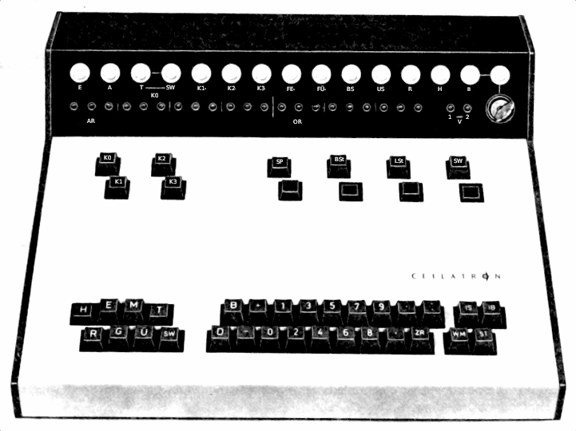
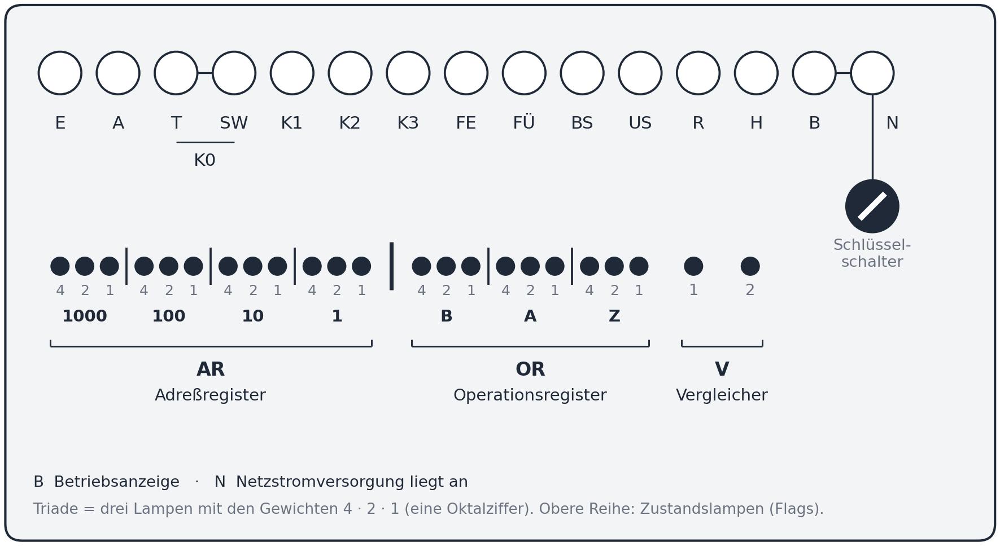
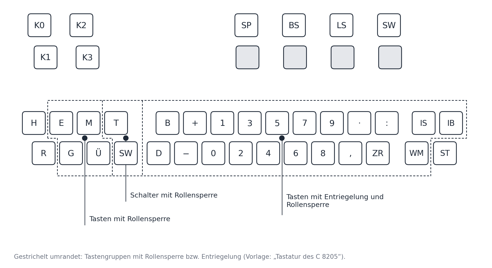

** Bedienpult mit Schaltern **

Version: 0.03-002

Im physischen Bedienpult des Rechners C8205 sind sowohl Schalter, Eingabetasten und Lampen,
die die Flag-Zustände anzeigen, lokalisiert.
Im Rechner werden die Schalterzustände in gleichnamigen Flags gespeichert als 0/1-Werte.

## Aufbau des Bedienpults

Das Bedienpult heißt in den Originalunterlagen „Tastatur-Anzeige-Einheit“ (Nr. 5 der Gesamtansicht in
`C8205-Interpreter-Überblick_und_Gesamtaufbau.md`, Abschnitt 2). Oben liegt das Lampenfeld (Abbildung 2). Darunter stehen
links die Kanalauswahltasten K0 bis K3, paarweise untereinander (K0 über K1, K2 über K3), und rechts die Schalter SP, BS
und LS sowie die Umschalttaste T-SW (beschriftet „SW“). Unter jeder dieser vier Tasten liegt eine weitere Taste, die auf
Foto und Zeichnung unbeschriftet ist. Unten liegt die Tastatur (Abbildung 3). Auf dem Foto tragen die Schalter rechts die
Beschriftung „BSt“ und „LSt“; dieses Regelwerk schreibt durchgehend „BS“ und „LS“.

*Abbildung 1: Das Bedienpult des C 8205 (Foto, Originalunterlagen)*

## Lampenfeld

Die obere Reihe (große Lampen) zeigt die Zustände E, A, T, SW, K1, K2, K3, FE, FÜ, BS, US, R, H, B und N; T und SW
gehören zur Anzeige des Kanals K0. Die Lampe B ist die Betriebsanzeige, die Lampe N zeigt an, dass die
Netzstromversorgung anliegt; unter N sitzt ein Schlüsselschalter. Die untere Reihe zeigt das Befehlsregister in Triaden zu
je drei Lampen mit den Gewichten 4, 2, 1: vier Triaden Adreßregister AR (oktale Wertigkeiten 1000, 100, 10, 1) und drei
Triaden Operationsregister OR (B, A, Z). Rechts davon zeigen die Lampen V 1 und V 2 den Vergleicherstand. Die Bedeutung der
Zustandslampen steht in `C8205-Interpreter-Datenstruktur_und_Verarbeitungseinheiten.md` (bei den Flags).

*Abbildung 2: Lampenfeld des Bedienpults mit Gewichten und Wertigkeiten der Befehlsregisteranzeige (neu gezeichnet nach Abb. 6 „Lampenfeld“ der Bedienungsanleitung des C 8205 und der Tabelle „Bedeutung der Befehlsregisteranzeige“)*

## Tastenanordnung

Abbildung 3 zeigt die Tasten des Bedienpults nach der Zeichnung „Tastatur des C 8205“; die Kanalauswahltasten K0 bis K3
stehen hier nach dem Foto. Gestrichelt umrandet sind die drei Gruppen, die die Zeichnung ausweist:

- **Tasten mit Rollensperre:** E, M, G, Ü,
- **Schalter mit Rollensperre:** T und SW,
- **Tasten mit Entriegelung und Rollensperre:** B, +, 1, 3, 5, 7, 9, „.“, „:“, D, −, 0, 2, 4, 6, 8, „,“, ZR, IS, IB und WM.

H und R (gegeneinander verriegelt, s. Schalter „H-R“) und ST (elektronisch verriegelt) gehören keiner Gruppe an. Die
Zeichnung erklärt die Begriffe „Rollensperre“ und „Entriegelung“ nicht.

*Abbildung 3: Tastatur des Bedienpults mit den Tastengruppen (neu gezeichnet nach der Zeichnung „Tastatur des C 8205“ und dem Foto)*

## Netzschalter

Der Netzschalter schaltet die Stromversorgung des Rechners ein. Das ist Voraussetzung für den Betrieb.

## Schalter "H-R" (Halt – Rechnen)

Schalter mit zwei gegeneinander verriegelten Tasten "H" und "R" (immer nur eine der beiden gedrückt).
In Stellung "H" geht der Rechner in den Halt- (Stopp-)Zustand über.

"H" und "R" sind gegeneinander verriegelt. Die Tasten "E", "M", "G", "Ü" und der Schalter "SW" lassen
sich nur bei Stellung "H" betätigen. Die Taste "ST" ist elektronisch verriegelt.
Durch Einrasten von "H" kann die Befehlsabwicklung unterbrochen werden; unabhängig vom Zeitpunkt des
Eingriffs im Phasenablauf wird erst nach der nächsten Phase III gestoppt.
Durch Drücken von "R" wird diese Sperre aufgehoben, die Abarbeitung eines Programms wird fortgesetzt.

## Tasten E, G, M, Ü, SW, ST

Diese Tasten/Schalter sind – bis auf "ST" – nur bei Schalter "H-R" in Stellung "H" wirksam.

- **Taste "E" – Einzelschritt**
  Mit "E" kann eine Befehlsfolge in Einzelschritten abgearbeitet werden. Beim Niederdrücken werden
  entsprechend dem Phasenablauf die Phase IV und die Phase I freigegeben; solange "E" gedrückt bleibt,
  steht der Automat vor Phase II. Bei verkürzten Gruppen- bzw. Wiederholungsbefehlen mit X-Abbruch wird
  bei gedrückter "E"-Taste das Einschalten von Phase II nicht verhindert.
  Beim Loslassen von "E" werden Phase II und Phase III durchlaufen; danach stoppt die Abarbeitung wieder.
  Erneutes Anschlagen löst den nächsten Schritt aus.

- **Taste "G" – Generallöschen**
  Beseitigt einen programmierten Stopp sowie einen eventuellen Überlauf und löscht das Befehlsregister
  (Einstellung "0000 000" = unbedingter Sprung nach Speicherplatz Null). Wählt zusätzlich Kanal K0 an.
  Kein Einfluss auf Akkumulator- und Befehlszählerinhalt.

- **Taste "M" – Manuell**
  (Für den Interpreter hat M nur die zwei Stellungen "gedrückt" und "losgelassen"; das Antippen "M" in einer
  Tastenfolge ist gleichbedeutend mit M gedrückt und sofort losgelassen, z. B. Fall 4 unter 4.1: H, M, R.)
  Verknüpft den Inhalt des Operationsregisters disjunktiv mit der Operation "025" (Sprung mit
  Rückkehrabsicht). Nach vorherigem "G" ergibt sich damit "0000 025". Bei gedrückter "M"-Taste und
  Betätigung von "E" wird die Befehlsentnahme in Phase II verhindert.
  Nach einem unbedingten Stopp (Befehl 02Z, Z<4) entsteht aus 02Z ∨ 025 die Operation 025 (Z=0, 1) oder 027 (Z=2, 3).
  Da Phase III des Stop-Befehls bereits abgelaufen ist, wird von dieser Operation nur die Resultatbehandlung
  ausgeführt (Linksverschiebung des AC, bei 027 zyklisch); die Sprungoperation selbst (Sichern der Rückkehradresse
  im AC) und die Löschanweisung gehören zu Phase III und entfallen. Anschließend wird der nächste Befehl aus der
  Speicherzelle entnommen, die im Adreßteil des Stop-Befehls angegeben ist (Phase II mit AR). Originaldokumentation
  4.3.2.3, Abb. 19 (Ergänzung 04.10.2026; Zusammenfassung im Abschnitt "Fortsetzung nach einem Stopp").

- **Taste "Ü" – Übertrag**
  (Nur bei Schalter H-R in Stellung "H" wirksam, sonst ohne Wirkung.)
  Stellt im Adressregister die Adresse "7777" (oktal) ein und verknüpft den Inhalt des
  Operationsregisters disjunktiv mit der Operation "240" (Transport, wenn OR vorher 000 war, z. B. nach "G").
  Nach einem Stop-Befehl entsteht stattdessen die Operation 26Z (s. "Fortsetzung nach einem Stopp"): Phase IV läuft
  dann mit dem Befehl "7777 26Z" (Originaldokumentation 4.3.2.3, Ergänzung 04.10.2026).

- **Schalter "SW" (Stellungen "T"/"SW", daher auch als "T-SW" bezeichnet) – Tastatureingabe/Schreibwerkeingabe**
  Unterscheidet beim Anwahlkanal K0 zwischen Tastatur- und Schreibwerkeingabe. Drücken von "SW" setzt
  Flag SW; Lösen (Stellung "T") löscht Flag SW und setzt stattdessen Flag T – "T" und "SW" sind
  alternativ. Bei Benutzung des Schreibwerks zur Eingabe muss "SW" gedrückt sein, Tastatureingabe nur bei Stellung
  "T". Der Schalter selbst hat keinen Einfluss auf die Anwahl eines peripheren Gerätes.

- **Taste "ST" – Start**
  (Für den Interpreter: nicht an Stellung H gebunden; ohne US/BS ohne Wirkung; Wirkung OR := OR ∨ 240, AR bleibt,
  US wird gelöscht; BR ist danach aufgestellt und wird durch E oder R ausgeführt.)
  Verknüpft den Inhalt des Operationsregisters disjunktiv mit der Operation "240". Elektronisch
  verriegelt: nur wirksam, wenn der Rechner im Zustand "Bedingter Stopp" oder "Unbedingter Stopp" steht.
  Nach einem Stop-Befehl (02Z bzw. 06Z, Z<4) entsteht so die Operation 26Z (Konjunktion mit negiertem
  Akkumulatorinhalt); die Fortsetzung verläuft wie bei dieser Operation (Originaldokumentation 4.3.2.3,
  Ergänzung 04.10.2026).

## Eingabetasten

Umfassen die Zeichen 0…9, +, −, „,", „.", „:", B, D, ZR, WM, IS, IB.
Betätigbar nur, wenn:
  - Kanal K0 angewählt ist,
  - Schalter "SW" in Stellung "T" steht,
  - ein Eingabe-Halt-Befehl im Befehlsregister steht.

**Wirkung:** Ist ein Eingabebefehl aufgestellt, stoppt der Automat nach Phase III. Beim Anschlagen wird
die dem Zeichen zugeordnete Eingabeverschlüsselung (gemäß R300-Code, Kodetabellen Tabelle 1) disjunktiv mit dem Inhalt
des Adressregisters verknüpft; danach wird die Sperre durch Umstellung des Eingabebefehls aufgehoben.
Zeitlich (Originaldokumentation 4.3.2.2): Mit dem Niederdrücken der Taste finden Paritätsprüfung und Auswertung der
Operationsumstellungsbedingung statt; mit dem Loslassen beginnt die Fortsetzung der Befehlsschleife mit der
disjunktiven Übernahme des Zeichens ins Adreßregister. Die Sonderzeichen "Irrung Zeichen" und "Transportloch im Vorspann"
entfallen bei Tastatur- und Schreibwerkeingabe.
Die Verschlüsselung der einzelnen Tasten steht in den (später zu besprechenden) Codetabellen.

Sonderbedeutung einzelner Tasten:
  - **ZR** – Zwischenraum, identisch mit Leerzeichen
  - **WM** – Wortmarke, identisch mit dem Code für Tabulator (TAB)
  - **IS** – Irrung Satz (gemäß Codetabelle)
  - **IB** – Irrung Block (gemäß Codetabelle)
  - **B** (nicht der Buchstabe B) – Sondertaste für Programmbaustein-Ansprung des BIS, nicht weiter benötigt
  - **D** (nicht der Buchstabe D) – Sondertaste für Programmbaustein-Ansprung des BIS, nicht weiter benötigt

## Kanalauswahltasten

Jede Kanalauswahltaste wählt einen Kanal gleichzeitig für Ein- und Ausgabe aus, wobei Eingabe- und
Ausgabegerät unterschiedlich sein können; ob der Eingabe- oder der Ausgabeaspekt genutzt wird,
bestimmt der abgearbeitete Befehl. Maßgebend ist der Moment des Drückens: Das entsprechende Flag wird
auf 1 gesetzt, die Flags der anderen drei Kanäle auf 0.

Besonderheit K0: Diese Taste hat kein eigenes Flag, sondern die zwei Subflags "T" (Tastatur) und "SW"
(Schreibwerk statt Tastatur) sind ihr zugeordnet. Beim Drücken von K0 ist der Zustand des Schalters "SW"
(s. o., Stellungen T/SW) maßgeblich: ist "SW" gedrückt, wird beim Drücken von K0 Flag SW gesetzt, sonst
Flag T. Anstelle der Tasten kann die Kanalanwahl auch per Befehl erfolgen; er berücksichtigt den
Schalterstatus SW analog.

| Taste | Anwahlverschlüsselung (programmiert) | Gerät |
|-------|---------------------------------------|-------|
| K0    | 4700 030 | Tastatureingabe* / Schreibwerkeingabe* |
| K1    | 4600 030 | Leser 1 / Lochbandstanzer |
| K2    | 4500 030 | Leser 2 / Schreibwerkausgabe |
| K3    | 4400 030 | frei |

## Selektoren: Schalter "SP" und "BS"

SP und BS sind einrastende Schalter: Gedrückt bleiben sie eingerastet, bis ein Mensch sie löst; das gleichnamige
Flag ist 1, solange der Schalter eingerastet ist, und 0, wenn er gelöst ist. Die Taste "G" kann eingerastete
Schalter mechanisch nicht bedienen und ändert deshalb die Flags SP und BS nicht (ebenso wenig H). Zur Definition
einer Tastenfolge genügt: Schalter gedrückt → Flag := 1, Schalter gelöst → Flag := 0.

Die Selektoren umfassen die Schalter "SP" und "BS". Ihre Stellungen werden als Bedingungen für die
Befehle "Bedingter Sprung mit Rückkehrabsicht" (SP) und "Bedingter Stopp" (BS) interpretiert; die
Bedingung ist erfüllt, wenn der entsprechende Schalter gesetzt ist.
Bei ausgeführtem "Bedingten Stopp" bleibt der Automat nach Phase III stehen; durch Lösen des Schalters
"BS" kann die Sperre aufgehoben werden.

## Schalter "LS" und Stellung "SW" (Lochbandstanzer / zusätzlicher Effekt des Schalters SW)

"LS" ist nur für den physischen Rechner C8205 von Bedeutung; bei der interpretativen Nachbildung der
Befehlsverarbeitung spielt er keine Rolle. Bei gesetztem "LS" läuft der Motor des Lochbandstanzers
ständig (sinnvoll bei Stanzvorgängen in kurzen Abständen unterhalb der 3-Sekunden-Abschaltverzögerung);
bei nicht gesetztem "LS" läuft der Motor nicht, ein Stanzvorgang beginnt dann erst nach Ablauf der
Einschaltverzögerung (Hochlauf).

"SW" bezeichnet hier keinen zweiten Schalter, sondern die bereits oben beschriebene Stellung "SW" des
Schalters "SW"/"T-SW". Auf die Schreibwerk**ausgabe** über Kanal K2 hat die Stellung dieses Schalters
KEINEN Einfluss; die Ausgabe über K2 ist unabhängig davon jederzeit möglich. Die Stellung "SW" betrifft
ausschließlich die Eingabeseite (Zeicheneingabe über das Schreibwerk an Kanal K0) – siehe dazu Datei
"C8205-Interpreter-Lochstreifenleser.md", Abschnitt A5.

## Bahnsperrenschalter

Räumlich und bedientechnisch am Bedienpult angesiedelt (rückseitig an der Tastatur-Anzeige-Einheit),
inhaltlich aber von der Magnettrommel ausgewertet – daher vollständig im Dokument zur Magnettrommel
beschrieben (Abschnitt "Bahnsperrenschalter" in C8205-Interpreter-Magnettrommel.md).

## Tastenfolge-Token (Schreibweise der Bedienhandlungen in einer Testdefinition)

Eine Tastenfolge beschreibt die Bedienhandlungen am Pult, die den Ausgangszustand vor dem Eintritt in den
Befehlsablauf festlegen (Dokument "C8205-Interpreter-Durchführung_eines_Tests.md", Abschnitt 3). Sie besteht aus
Token, die durch Leerzeichen getrennt in einer oder mehreren Zeilen stehen; `#` beginnt einen Kommentar bis zum
Zeilenende. Groß-/Kleinschreibung ist gleichgültig. Die Wirkungen sind die der oben beschriebenen Tasten und Schalter.

| Token | Bedeutung und Wirkung |
|---|---|
| `H` | Schalter H-R auf "H": Flag H := 1 |
| `R` | Schalter H-R auf "R": Flag H := 0; zusätzlich US := 0. Der Befehlsablauf beginnt (Startpunkte: s. unten) |
| `G` | Generallöschen (nur bei H): alle Flags außer H, T, BS und SP := 0 (BS und SP sind eingerastete Schalter, G kann sie mechanisch nicht lösen); AR := 0000, OR := 000 (BR = "0000 000"); K0 wird angewählt (T := 1, bei gedrücktem Schalter SW: SW := 1); BZ und AC bleiben unverändert (G setzt BZ nicht; durch den aufgestellten BR 0000 000 kommt es zum Sprung nach 0000 und damit zu BZ := 0000, sobald `R` oder `E` ohne `M` ihn ausführt; folgt `M+ E … E M-`, entfällt der Sprung. Anfangswerte von AC und BZ kann ein Test über die Testmarken `#AC=` und `#BZ=` vorgeben, `C8205-Interpreter-Durchführung_eines_Tests.md`, Abschnitt 2); danach US := 1 (wird durch ST oder R wieder gelöscht) |
| `M+` (auch `M-drücken`, `M-gedrückt-halten`) | M gedrückt halten (nur bei H): OR := OR ∨ 025 |
| `M-` (auch `M-loslassen`) | M loslassen. Wurde unter gehaltenem M kein E betätigt, bleibt BR = ⟨AR⟩ 025 aufgestellt. Wurde mindestens ein E betätigt, entfällt der Beitrag 025 im OR (übrige Anteile, z. B. von Ü, bleiben) |
| `M` | Antippen, gleichbedeutend mit `M+` und sofort danach `M-` |
| `E` | Einzelschritt (nur bei H). Ohne M: Phase IV und I, dann Phase II und III, danach Halt (Halt-Punkt vor Knoten 19). Steht der Automat nach einem E unter M vor Phase II, beginnt E bei Phase II. Unter gehaltenem M: Phase II entfällt; BZ := BZ+1, AR := BZ, der AC enthält im Adressfeld den Wert BZ+1 (übrige Stellen 0) |
| `Ü` | Übertrag (nur bei H, sonst ohne Wirkung): AR := 7777, OR := OR ∨ 240; BR ist aufgestellt und noch nicht ausgeführt |
| `ST` | Start (nicht an H gebunden, aber nur bei US oder BS wirksam, sonst ohne Wirkung): OR := OR ∨ 240, AR unverändert, US := 0; BR ist aufgestellt und noch nicht ausgeführt |
| `SW=1` (auch `SW+`, `SW-drücken`) | Schalter SW gedrückt: Flag SW := 1, T := 0 |
| `SW=0` (auch `SW-`, `SW-loslassen`) | Schalter SW gelöst: Flag SW := 0, T := 1 |
| `BS=1`, `SP=1` (auch `BS+`, `SP+`) | Selektorschalter gedrückt und eingerastet: gleichnamiges Flag := 1 |
| `BS=0`, `SP=0` (auch `BS-`, `SP-`) | Selektorschalter gelöst: gleichnamiges Flag := 0 |
| `K0` … `K3` | Kanalauswahltaste: Flag des gewählten Kanals := 1, die Flags der anderen drei Kanäle := 0 (K0: T oder SW je nach Schalter SW) |

Hinweise:
- `SW` muss vor `G` gesetzt werden, weil `G` daraus für K0 das Flag T oder SW ableitet.
- Die Eingabetasten (0…9, +, − usw.) gehören nicht in die Tastenfolge; sie werden als K0-Eingabe während des Ablaufs bedient.
- Eine Tastenfolge wird bis zur Wirkung der dadurch aufgestellten Instruktion vorausinterpretiert. Sie muss den
  Ausgangszustand vollständig definieren (Gültigkeitsregeln: Dokument "C8205-Interpreter-Durchführung_eines_Tests.md",
  Abschnitte 3.3 und 5). Sie endet mit `R` oder im Halt (H gesetzt).
- **Startpunkte nach `R`:** Ist keine Instruktion in BR aufgestellt (z. B. nach `H G R` oder `H G M+ E … E M- R`),
  beginnt der Ablauf bei Konnektor B mit dem in BZ stehenden Wert. Ist BR aufgestellt und noch nicht ausgeführt
  (nach `Ü`, `ST`, `M` ohne E oder nach `E` ohne M), beginnt der Ablauf bei Knoten 19 (Ausführung von BR).
  **Ausnahme (Ergänzung 04.10.2026):** Ist der durch `M` (ohne E) aufgestellte BR ein Sprung mit Rückkehrabsicht
  (B=0 oder 1, A=2, Z≥4: 025, 027, 125, 127), gilt Phase III als abgelaufen. Der Ablauf beginnt dann bei Konnektor 4
  (Knoten 54) und führt nur die Resultatbehandlung aus (Abschnitt "Fortsetzung nach einem Stopp").
  Endet die Tastenfolge ohne `R`, bleibt der Rechner im Halt; das Ergebnis ist der Zustand nach dem letzten Schritt.
- **Makro `#STARTE n` (Ergänzung 09.10.2026):** steht in einer Testdatei für die Tastenfolge `H G M+ E … E M- R` mit n Anschlägen von `E`, also den
  Ansprung des Speicherplatzes n (Abschnitt 4.4, Punkt 2; `C8205-Interpreter-Durchführung_eines_Tests.md`, Abschnitt 2e).
- **Tastenfolge als Argument von `#INTERRUPT` (Ergänzung 08.10.2026):** Dieselben Token dürfen auch hinter `#INTERRUPT H` stehen und
  unterbrechen dann den Programmlauf zwischen zwei Befehlen (`C8205-Interpreter-Durchführung_eines_Tests.md`, Abschnitt 2d). Endet
  eine solche Folge mit `R` oder `ST`, läuft das Programm weiter, sonst endet der Test im Halt.

## Fortsetzung nach einem Stopp (Originaldokumentation 4.3.2.3, Abb. 19; Ergänzung 04.10.2026)

Ein programmierter Stopp (unbedingter Stop 1. Art: A=2 und Z<4; bedingter Stop bei gesetztem Schalter "BS") unterbricht
die Befehlsschleife am Ende der Phase III, also **vor der Wartezeit W₂**. Die Lampe US bzw. BS zeigt ihn an. Ein Halt
wegen Überlauf zeigt nur die Lampe FÜ. Weil Phase III des Stop-Befehls bereits abgelaufen ist, wirken die Tasten nicht
auf Phase III, sondern bilden einen neuen Befehl, der ab Phase IV ausgeführt wird:

| Bedienung | Operationsteil (OR des Stop-Befehls 02Z, Z<4) | Ablauf |
|---|---|---|
| `ST` (Start) | OR ∨ 240 = 26Z (Konjunktion mit negiertem AC, ⟨a⟩ := (¬AC) ∧ ⟨a⟩) | Wartezeit W₂, Überlauftest, Phase IV mit ⟨AR⟩ 26Z, dann Phase I |
| `H Ü R` | wie ST, zusätzlich AR := 7777 | wie ST, Phase IV mit "7777 26Z" |
| `H M R` | OR ∨ 025 = 025 oder 027 (Sprung mit Rückkehrabsicht) | Überlauftest, Phase IV nur mit Resultatbehandlung (Linksverschiebung, bei 027 zyklisch), Wartezeit W₁, Phase II: nächster Befehl aus der im Adreßteil des Stop-Befehls angegebenen Zelle (AR) |
| Lösen des Schalters "BS" (nur bedingter Stopp) | – | wie nicht erfüllte Schalterbedingung: Überlauftest, eine Wortzeit, Phase I |

- Nach `G` (OR = 000) ergibt dieselbe Tastenkombination eine andere Operation: `Ü` und `ST` führen zu 240 (Transport),
  `M` zu 025.
- Beim bedingten Stopp (06Z) ergibt `ST`/`Ü` ebenfalls 26Z (aus der Rechnung 06Z ∨ 240 abgeleitet; das Original nennt
  nur den unbedingten Stopp). `H M R` ergibt 065 oder 067 und läuft wie ein nicht ausgeführter Sprung mit Phase I weiter.
- Nach einem Halt wegen Überlauf zeigt Abb. 19 keine Fortsetzung durch `ST`, `Ü` oder `M`; der Überlauf wird durch `G`
  beseitigt (s. Abschnitt 4.1).
- Im Interpreter werden diese Folgen als Tastenfolge vorab ausgewertet (Abschnitt "Tastenfolge-Token"). Einstiegsknoten:
  `ST`, `Ü`, `E` → Knoten 19; `M` mit Sprung mit Rückkehrabsicht → Knoten 54.

## Typische Funktionsabläufe unter Benutzung der Schalter und Tasten (Eingriffsmöglichkeiten)

### 4.1 Beseitigen der Betriebszustände "US", "BS", "FÜ", "FE"

Zustand "Unbedingter Stopp" (US) kann geändert werden durch:
  1. a) Schalter "H-R" → "H"; b) Taste "G"; — Programm wird unterbrochen.
  2. a) Schalter "H-R" → "H"; b) Taste "G"; c) Taste "ST" — US wird übergangen (Sprung zur Adresse des
     US-Befehls).
  3. a) Schalter "H-R" → "H"; b) Taste "Ü"; c) Schalter "H-R" → "R" — US wird übergangen (Speicherplatz
     7777 oktal wird angesprungen/geändert).
  4. a) Schalter "H-R" → "H"; b) Taste "M"; c) Schalter "H-R" → "R" — Sprung zur Adresse des US-Befehls,
     Akkumulatorinhalt wird der Resultatbehandlung unterworfen.

Zustand "Bedingter Stopp" (BS) verhält sich wie US (gleiche Fälle 1–4), zusätzlich: Lösen des Schalters
"BS"; bei Beseitigung gemäß Fall 4 wird der nächste Befehl abgearbeitet.
Ergänzung 04.10.2026 (Originaldokumentation Abb. 19): Das Lösen des Schalters "BS" ist ein eigener Weg aus dem
Stopp und führt wie eine nicht erfüllte Schalterbedingung über den Überlauftest und eine Wortzeit zu Phase I. Bei
Fall 4 ergibt 06Z ∨ 025 (= 065 oder 067) einen bedingten Sprung mit Rückkehrabsicht, der ohne Phase IV und ohne
Verschiebung mit dem nächsten Befehl (Phase I) weiterläuft.

Zustand "Überlauf" (FÜ) wird beseitigt durch:
  1. a) Schalter "H-R" → "H"; b) Taste "G" — Programm wird unterbrochen.
  2. a) Schalter "H-R" → "H"; b) Taste "E" gedrückt halten; c) Taste "G"; d) Taste "E" loslassen — nur
     der Überlauf wird gelöscht (Generallöschen bei gedrückter Einzelschritt-Taste).

Zustand "Fehler bei Eingabe" (FE) kann nur durch Generallöschen ("G") aufgehoben werden.

### 4.2 Transport des Akkumulatorinhaltes nach Speicherplatz 7777 (oktal)
a) Schalter "H-R" in Stellung "H"
b) Taste "G" anschlagen
c) Taste "Ü" anschlagen
d) Taste "E" anschlagen

Der Inhalt des Akkumulators wird nach dem Speicherplatz 7777 (oktal) transportiert. Der in den Schritten b) und c)
aufgestellte Befehl "7777 240" wird durch d) ausgeführt.

### 4.3 Transport des Befehlszählerinhaltes nach dem Akkumulator
a) Schalter "H-R" in Stellung "H"
b) Taste "G" anschlagen
c) Taste "M" gedrückt lassen
d) Taste "E" anschlagen
e) Taste "M" loslassen
f) Taste "E" anschlagen

(Wortlaut nach der Originaldokumentation, Seitenabbild, Ergänzung 08.10.2026: Schritt f) ist "Taste E anschlagen", nicht "Schalter H-R → R".
Der Ansprung eines Druckprogramms nach einer Programmunterbrechung endet dagegen mit "SP lösen" und R, siehe Dokument BIS.)

Danach steht im Akkumulator die um 2 Einheiten erhöhte Adresse des nächsten abzuarbeitenden Befehls
(meist ein Sprung in ein Druckprogramm). Wird in Schritt d) "E" zweimal angeschlagen, steht die um 3
Einheiten erhöhte Adresse im Akkumulator, Speicherplatz "0002" wird als nächster Befehl aufgestellt.
Alternativ kann im Haltzustand durch Niederdrücken von "E" (außer bei X-Befehlen) der
Befehlszählerstand im Adressteil des Befehlsregisters sichtbar gemacht werden.

### 4.4 Manueller Ansprung einer Speicherzelle
1. Ansprung des Platzes "0000": a) Schalter "H-R" → "H"; b) Taste "G"; c) Schalter "H-R" → "R".
2. Ansprung eines beliebigen Speicherplatzes n: a) Schalter "H-R" → "H"; b) Taste "G"; c) Taste "M"
   gedrückt halten; d) Taste "E" n-mal anschlagen; e) Taste "M" loslassen; f) Schalter "H-R" → "R".

### 4.5 Hinweise zum "Kleinen Eingabeprogramm"
Ermöglicht die Eingabe von Befehlen, Zahlen und Hilfsadressen über ein einfaches Leseprogramm (liegt auf
Spur 0, wird über Speicherplatz "0002" angesprungen, bei gesetztem Sperrschalter gegen Überschreiben
gesichert; nur über eine Serviceeinheit bei völlig gelöschtem Speicher nutzbar). Verarbeitet nur die
Zeichen "0", "1", Punkt ".", Doppelpunkt ":" und Zwischenraum "ZR". Worte werden entsprechend ihrer
dualen Darstellung eingegeben (Beginn beim ersten von Null verschiedenen Bit möglich) und im
Akkumulator aufgebaut. "." und ":" dienen als Schlusszeichen: ":" speichert die aufgebaute Information
als Befehl auf Speicherplatz "7723" (Leitbefehl); "." führt den Leitbefehl aus (bei Transportbefehl
"a1 a2 a3 a4 240" wird das zuvor aufgebaute Wort nach Zelle a1 a2 a3 a4 abgespeichert) und erhöht
dessen Adresse um 1, sofern kein Sprungbefehl vorliegt. "ZR" löscht die im Akkumulator aufgebaute
Information, solange noch kein Schlusszeichen gegeben wurde.
