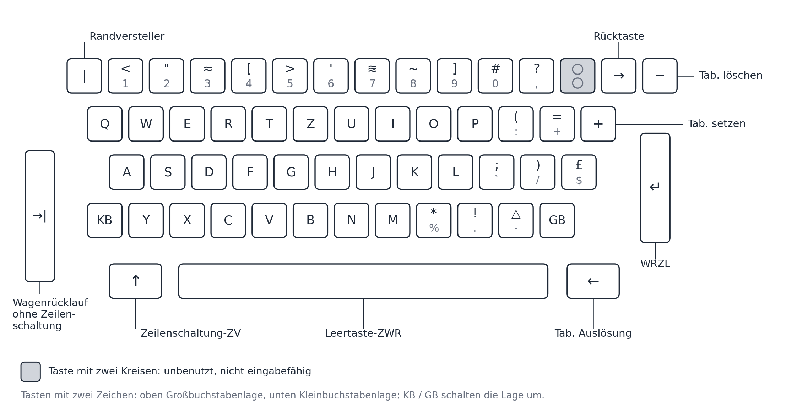

# Lochstreifenleser

Version: 0.95-001

Hardwarebeschreibung des Lochstreifenlesers 303 am Rechner C 8205.

Die Zeichenkode-Tabellen (Zeichenkode des Lochbands) stehen in der Datei
"C8205-Interpreter-Kodetabellen.md", Abschnitt 1; dorthin wird an
den entsprechenden Stellen verwiesen. Die vollständige Kanaltabelle (K0–K3)
und die Bedienelemente stehen in der Datei
"C8205-Interpreter-Bedienpult_mit_Schaltern.md"; hier steht nur, was zum
Verständnis des Lesers nötig ist.

## Inhaltsverzeichnis

- [A0 Überblick](#a0-überblick)
- [A3 Geschwindigkeit](#a3-geschwindigkeit)
- [A4 Lochbandkode (Tabelle 1)](#a4-lochbandkode-tabelle-1)
- [A5 Anschluss an den Rechner](#a5-anschluss-an-den-rechner)
- [A5a Beispiel: Lochband kopieren (Leser 1 nach Stanzer 1)](#a5a-beispiel-lochband-kopieren-leser-1-nach-stanzer-1)
- [A6 Namenskollisionen](#a6-namenskollisionen)
- Lochstreifenstanzer:
  - [B0 Überblick](#b0-überblick)
  - [B3 Geschwindigkeit](#b3-geschwindigkeit)
  - [B4 Kode](#b4-kode)
  - [B5 Anschluss an den Rechner / Ablauf einer Zeichenausgabe](#b5-anschluss-an-den-rechner--ablauf-einer-zeichenausgabe)
  - [B6 Namenskollisionen](#b6-namenskollisionen)
- Schreibwerk (Ausgabe):
  - [C0 Überblick](#c0-überblick)
  - [C1 Kanal und Sperrwirkung des Schalters "SW"/"T-SW"](#c1-kanal-und-sperrwirkung-des-schalters-swt-sw)
  - [C2 KB/GB-Gedächtnis bei der Ausgabe](#c2-kbgb-gedächtnis-bei-der-ausgabe)
  - [C3 Ablauf einer Zeichenausgabe](#c3-ablauf-einer-zeichenausgabe)
  - [C4 Tastatur des Schreibwerks (Eingabe)](#c4-tastatur-des-schreibwerks-eingabe)

Hinweis zur Nummerierung: Die Abschnittsnummern A1, A2 sowie B1 und B2 sind in diesem Dokument nicht vorhanden (die
Gliederung springt von A0 auf A3 bzw. von B0 auf B3).

---

## A0 Überblick

| Merkmal | Angabe |
|---|---|
| Bezeichnung | Lochbandleser 303. "Lochband" und "Lochstreifen" sind Synonyme; in diesem Dokument "Lochstreifenleser" (Kürzel LL) bzw. "Leser" |
| Hersteller | Secura-Werke |
| Vorgänger | Leser 301 (der 303 war dessen Nachfolger) |
| Bandbreite | normalerweise 8-spurige Lochbänder |
| Bauform | mit Gehäuse als Auftischgerät ODER gehäuselos zum Einbau in die Gerätefrontblende |
| Einsatz | u. a. am Computer "Cellatron C8205" sowie an Papierverarbeitungsmaschinen |
| Ausführung "Doppel-Lochbandleser 303" | Am Rechner hängt Leser 1 an Kanal K1 und Leser 2 an Kanal K2; s. A5 |

Zusammenhang mit dem Flag FE (Definition siehe Datei "C8205-Interpreter-Datenstruktur_und_Verarbeitungseinheiten.md"): FE ("Fehler bei Eingabe") ist ein logischer
Fehler — ein Fehler in den einzugebenden Daten; er kann bei Ausgabe nicht
auftreten. Alle anderen Fehler bei Ein- und Ausgabe sind physische Fehler
(Fehler der Geräteelektronik) und werden nicht in Flags des Rechners
abgebildet. Eine Zeile mit gerader Zahl gelochter Spuren (kein gültiges
Zeichen, s. A4) ist ein solcher logischer Fehler in den Daten: Flag FE wird
gesetzt und der Rechner stoppt. Ausgenommen sind Zeilen ohne Datenlochung
(Vorspann), die der Leser überliest, sowie "Irrung Zeichen", das er
überspringt (s. A4).

## A3 Geschwindigkeit

130 Zeichen/s. Der Leser ist der Standardleser des C 8205 (mechanisch,
Metallbürsten).

## A4 Lochbandkode (Tabelle 1)

Die Tabelle 1 selbst (55 Zeilen mit Lochbildern), die Spaltenbedeutungen,
die Konsistenzprüfung, die Sonderzeilen und die Auffälligkeiten stehen in
der Datei "C8205-Interpreter-Kodetabellen.md", Abschnitt 1. Die
E/A-Befehle gehören sowohl zum Rechner als auch zum Leser bzw. Stanzer;
ihre Wirkung im Rahmen des Befehlsablaufs wird hier nicht behandelt.

**Kurzfassung (Details in den Kodetabellen):**

- **Spuren:** w v u p 8 Tr 4 2 1. Tr ist die Transportlochung ohne
  Information; die acht Datenspuren haben folgende Bitwerte im Lochbild:

| Spur | 1 | 2 | 4 | 8 | p | u | v | w |
|---|---|---|---|---|---|---|---|---|
| Bitwert | 1 | 2 | 4 | 10₈ | 20₈ | 40₈ | 100₈ | 200₈ |

- **Parität:** Alle gültigen Zeichen haben eine ungerade Zahl gelochter
  Datenspuren (p ergänzt). Eine Zeile mit gerader Zahl gelochter Spuren ist
  kein gültiges Zeichen und beim Lesen ein Gerätefehler (Flag FE wird
  gesetzt, der Rechner stoppt). "Irrung Zeichen" wird bei der Eingabe von der 
  Paritätsprüfung ausgeschlossen und übersprungen.
- **Leser:** maßgebend ist die Spalte "Eingabe Adresse" — ein Wert des
  Lesers, der ihn sendet; der Rechner muss ihn interpretieren.
  **Stanzer:** maßgebend ist die Spalte "Ausgabe-Adresse" — ein Wert des
  Rechners, der ihn sendet; die Stanzer-Elektronik muss ihn interpretieren.
  Über den Stanzer sind alle Zeichen der Spalte "Ausgabe-Adresse" ausgebbar,
  alle anderen nicht.
- **"Irrung Zeichen"/"Irrung Satz":** Der Rechner benutzt sie nicht; sie
  dienen der menschlichen Datenerfassung auf Lochstreifen.
- **Sprung-Umstellung:** gehört zur Befehlsdefinition, nicht zur
  Leserdefinition.

**Zeichenlage und Umschaltzeichen:**

- Um. KB / Um. GB bedeuten "Umschalten KB" bzw. "Umschalten GB".
- Die Zeichenlage Klbuch/Gbuch existiert physisch nur am Schreibwerk (SW):
  je nachdem, ob der Umschalter der Schreibmaschine eingerastet ist oder
  nicht; von dort kommt sie auch.
- Der Rechner steht nach dem Einschalten auf KB und merkt sich die
  Zeichenlage übergreifend, d. h. alle Leser werden damit beurteilt — es
  sei denn (und das ist die Regel), über den Leser kommt explizit ein
  Umschaltzeichen. Da immer nur ein Kanal gleichzeitig aktiv sein kann,
  entsteht kein Problem.
- Zeicheneingabe über das SW: Dazu muss K0 angewählt sein (durch Taste oder
  Befehl) und der Schalter SW gedrückt sein. Wird an der Schreibmaschine
  die Umschalttaste KB oder GB gedrückt, bekommt der Rechner auch das als
  Zeichen zugestellt. Eingabe von Umschaltzeichen erfolgt nur, wenn der
  schreibende Mensch es vorsieht; es gibt keine Automatik.
- Bei der Ausgabe durch den Rechner werden Umschaltzeichen nur ausgegeben,
  wenn das Programm es vorsieht; es gibt keine Automatik.
- "Irrung Zeichen" und "Irrung Satz" sind in beiden Zeichenlagen gleich.

## A5 Anschluss an den Rechner

**Kanäle und Geräte:** Die vollständige Kanaltabelle (K0–K3, manuelle
Anwahl, programmierte Anwahlverschlüsselung, alle angeschlossenen Geräte)
steht in der Datei "C8205-Interpreter-Bedienpult_mit_Schaltern.md",
Abschnitt "Kanalauswahltasten"; hier nur die für den Leser nötigen Fakten: Leser 1 hängt an Kanal K1, Leser 2 an Kanal K2,
Stanzer 1 hängt an Kanal K1. Kanal K3 ist beim C 8205 "frei" (kein Gerät
zugeordnet). K0 ist Tastatur- bzw. Schreibwerk-Eingabe (kein
Lochstreifenleser).

**Ablauf einer Zeicheneingabe:**

1. Im Rechenwerk des C 8205 wird ein Eingabebefehl ausgeführt
   ("Eingabe-Halt", Oberbegriff für zwei Eingabebefehlsarten, deren
   Unterschied hier nicht relevant ist).
2. Er veranlasst den Leser, dessen Kanal angewählt ist (Kx mit x ≠ 0), eine
   Position (Lochungszeile) vom Lochstreifen zu lesen, sofern einer
   eingelegt ist. Während dieses Vorgangs ist das Flag E gesetzt (Definition
   siehe Datei "C8205-Interpreter-Datenstruktur_und_Verarbeitungseinheiten.md": "=1, wenn ein
   Eingabebefehl aufgestellt ist").
3. Ist kein Lochstreifen eingelegt, wartet der Leser unendlich; der Rechner
   bleibt mit gesetztem Flag E stehen (kein Fehler).
4. Ist ein Lochstreifen eingelegt, werden die Lochungen gemäß Tabelle 1
   (Kodetabellen, Abschnitt 1) gelesen und in eine Eingabeadresse
   umgerechnet; diese ist ein Wert des Lesers, der ihn sendet (s. A4).
5. Die Eingabeadresse wird an das Rechenwerk übergeben, das mit ihrer Hilfe
   den Eingabebefehl abschließt (das Wie wird hier nicht erklärt, es
   gehört zur Befehlsdefinition).
6. Damit ist die Zeicheneingabe abgeschlossen; Flag E wird gelöscht, und
   der nächste Befehl kann verarbeitet werden.

Wie das Zeichen intern im Speicher kodiert wird, hängt davon ab, ob
zeicheneingabe-übergreifend VORHER ein Zeichen Klbuch oder Gbuch gelesen
wurde (Zeichenlage rechnerweit, Anfang KB, s. A4).

**Bedienung am Leser: Streifen einlegen und Streifenende**

- Der Lochstreifen kann schon eingelegt werden, wenn der Rechner noch gar
  keine Eingabe anfordert. Er bleibt dann einfach stehen und wartet, bis
  das der Fall ist.
- Fordert der Rechner eine Eingabe an, und ist kein Streifen eingelegt,
  bleibt der Rechner mit gesetztem Flag E stehen; das ist kein Fehler. Wird
  der Streifen dann eingelegt, beginnt die Eingabe sofort;
  Transportlochungen (Zeilen ohne Datenlochung) werden überlesen.
- Der Streifen wird so lange transportiert, wie Eingabebefehle vorliegen,
  bis er aus dem Leser herausfällt. Liegen keine Eingabebefehle vor, bleibt
  der Streifen mittendrin stehen.

## A5a Beispiel: Lochband kopieren (Leser 1 nach Stanzer 1)

Das Programm `Assembler/Projekt_1/sw_eingabe/k1_leser_stanzer.asm` (aus `sw_eingabe_lage.asm`) kopiert ein Lochband.

- **Eingabe:** erster Befehl `ANWAHL LSL1` (4600, Leser 1); das Programm liest Zeichen für Zeichen und speichert sie.
- **Bandende:** `:` in KB (Code 15) beendet die Eingabe. Dieses Zeichen wird **nicht** gestanzt. Dasselbe Bit-Muster (`00001101`) steht als `(` in GB als gewöhnliches Zeichen auf dem Band; nach `Um. GB` speichert das Programm Code 15 als normales Zeichen und deutet ihn nur in KB als Ende.
- **Ausgabe:** `ANWAHL LSS1` (4600, Stanzer 1). Ein Umschalten auf KB vor der Ausgabe gibt es nicht, damit das Band genau das enthält, was gelesen wurde. Am Ende steht der Stopp.
- **Test:** `python3 c8205_interp.py --MODUS=TEST Tests/k1_leser_stanzer.test` (Zeilen `--leser1 Test-virtuelleGeraete/Leser1/lb_kopie_quelle.txt`, `--stanzer1 Test-virtuelleGeraete/Stanzer1/lb_kopie_ausgabe.txt`, Tasten `H G R`). Testband: `Hallo Welt 123 (ok)!:` (29 Zeilen); gestanzt werden 28 Zeilen (Quelle ohne das Endzeichen). Ein anderes Band: nur die `--leser1`-Zeile ändern; das Band muss mit `:` in KB enden.
- **GRAFIK:** dasselbe Programm läuft im Modus GRAFIK mit `--leser1` und `--stanzer1` (vom Projektinhaber am 19.10.2026 geprüft: gleiche 28 Zeilen); Leser- und Stanzerton nach `C8205-Interpreter-GRAFIK_Beschreibung.md` §6.3 und §6.4 (S4-09, S4-10). Die Hörprüfung steht aus.

## A6 Namenskollisionen

Es werden Namensgleichheiten dokumentiert, nicht aufgelöst.

- **Spurbezeichnungen w, v, u, p** (Kopf der Lochspuren) kollidieren mit
  den gleichlautenden Zeichen w, v, u, p in Tabelle 1 (Klbuch) — andere
  Domäne (Lochspur vs. Zeichen).
- **Spuren 1, 2, 4, 8** kollidieren mit den Ziffern 1, 2, 4, 8 der Tabelle
  und mit den BCD-Zahlen (Stanzzonen 0, 11, 12 und Ziffernwerte).
- **Tr** (Spalte) — keine bekannte Kollision; zur Bedeutung s. A4
  (Transportlochung ohne Information).
- **"Leser 1"/"Leser 2"** (Kanalnamen) vs. "Doppel-Lochbandleser": Für die
  Leserdefinition ohne Belang; am Rechner Leser 1 an K1, Leser 2 an K2
  (s. A5).
- **"Transport":** Tabellenzeile "Transport" (Relikt, nie benutzt),
  "Transport Vorspann" (tatsächlicher Transport ohne Datenlochung), Spur
  Tr (Transportlochung) und der Transportmechanismus des Lesers
  (Reibrad/Zahnrad) sind verschiedene Dinge mit demselben Wortstamm.
- **"E":** Flag E ("=1, wenn ein Eingabebefehl aufgestellt ist", Datei
  "C8205-Interpreter-Datenstruktur_und_Verarbeitungseinheiten.md") — hier nur als Verweis in A5
  benutzt — und die gleichnamige Taste "E" (Einzelschritt) am Bedienpult
  sind getrennte Namensdomänen (Flag vs. Taste); für den Leser ist
  ausschließlich das Flag E relevant.

---

## A7 Töne und Haltzeit im Modus GRAFIK

**GRAFIK:** Im Modus GRAFIK klingt der Leser: Jedes Zeichen, das K1 oder K2 liefert, löst den Leserton aus (Einzelschritt, bei dichter Folge Dauergeräusch, danach Auslaufen; Lesetempo 130 Zeichen/s). Die reine Rechnerzeit bis zum nächsten Halt, auch bis zum E/A-Halt an einem Eingabebefehl, zeigt der Hardware-Check. Einzelheiten: `C8205-Interpreter-GRAFIK_Beschreibung.md`, Abschnitte 6.3 und 8.3.

# Lochstreifenstanzer

Hardwarebeschreibung des Lochstreifenstanzers am Rechner C 8205.

## B0 Überblick

| Merkmal | Angabe |
|---|---|
| Bezeichnung | Lochbandstanzer Cellatron C8021 (Kürzel LS, Kürzel-Kollision mit Schalter "LS", s. B6) |
| Bauform | Einbaugerät |
| Anzahl am Rechner | max. 1 Stanzer |

## B3 Geschwindigkeit

50 Zeichen/s ("maximale Stanzgeschwindigkeit"). Damit dauert ein Zeichen
20 ms. Bei voller Leistung können nach der Originaldokumentation (4.3.2.5) zwischen zwei aufeinanderfolgenden
Ausgabe-Halt-Befehlen höchstens 4,5 Trommelumdrehungen liegen. (Die Rechnung aus 20 ms und 32 × 104 µs = 3,3 ms je Umdrehung
ergäbe etwa 6; die Angabe des Originals ist hier unverändert übernommen.)

## B4 Kode

8-Kanal-Code (Tabelle 1 / R300-Kode), Paritätslochung im 5. Bit (Spur p,
Bitwert 20₈ = 2⁴). Der Stanzer erzeugt die Lochungen in den Spuren
w v u p 8 Tr 4 2 1 (w höchstwertig), gemäß Spalte "Ausgabe-Adresse C8205
oktal" der Kodetabellen (Abschnitt 1). Ausgebbar sind ausschließlich die
dort enthaltenen Zeichen.

## B5 Anschluss an den Rechner / Ablauf einer Zeichenausgabe

**Kanal:** K1 (gemeinsam mit Leser 1). Nur ein Stanzer vorhanden, anders
als bei den zwei Lesern.

**Ablauf (analog A5 beim Leser, jedoch Flag A statt E):**

1. Ausgabebefehl im Rechenwerk ausgeführt ("Ausgabe-Halt"). Das Zeichen wird, sobald der **1-Zeichen-Puffer** frei ist, in den Puffer
   übertragen; der Rechner wartet bis dahin. Die Ausgabe aus dem Puffer über das Gerät läuft danach unabhängig von der
   Zentraleinheit, die Befehlsschleife wird gleichzeitig fortgesetzt (Original 4.3.2.5, Abb. 21).
2. Kanal K1 muss angewählt sein; während des Vorgangs ist Flag A gesetzt
   (Definition Datei "C8205-Interpreter-Datenstruktur_und_Verarbeitungseinheiten.md": "=1,
   wenn ein Ausgabebefehl aufgestellt ist").
3. Die Ausgabe ist 1-Zeichen-gepuffert (Original 4.3.2.5): Ist ein Ausgabegerät angewählt, wird das Zeichen in den 1-Zeichen-Puffer
   übertragen, sobald dieser frei ist; bis dahin wartet der Rechner mit gesetztem Flag A. Ist kein Streifen eingelegt bzw. zu Ende,
   kann der Stanzer das Zeichen im Puffer nicht abarbeiten; der Rechner bleibt dann beim nächsten Ausgabe-Halt, der den belegten
   Puffer nicht füllen kann, mit gesetztem Flag A stehen (kein Fehler) — analog zum Leser.
4. Ist ein Streifen eingelegt, wird die Lochung gemäß Tabelle 1 (Spalte
   Ausgabe-Adresse) für das auszugebende Zeichen gestanzt.
5. Flag A wird mit der Umstellung des Ausgabebefehls gelöscht, also sobald das Zeichen im 1-Zeichen-Puffer liegt, nicht erst nach Abschluss
   des Stanzens (Bedienungsanleitung 2.3.2); der nächste Befehl kann verarbeitet
   werden. (Beim Interpreter gilt Wartezeit=0: Puffer und Stanzvorgang werden nicht zeitlich nachgebildet.)
6. Die zu stanzende Bitkombination ist identisch mit den Bits z₁₃ bis z₂₀ des Adreßteils; mit 1 besetzte Bits werden gelocht,
   mit 0 besetzte bleiben ungelocht (Lochkanal 1 = z₂₀, 2 = z₁₉, 3 = z₁₈, 4 = z₁₇, 5 = z₁₆, 6 = z₁₅, 7 = z₁₄, 8 = z₁₃).
   Damit kann jeder beliebige Kode mit höchstens 8 Kanälen realisiert werden.
7. Gibt es für den Ausgabe-Halt keine passende Anwahl, stoppt der Rechner mit gesetztem Flag A (Lampe A leuchtet, Original 4.3.2.5).

**Motorsteuerung:** Der Stanzermotor läuft nicht dauerhaft, sondern läuft
automatisch an, sobald ein Zeichen ausgegeben werden soll, und schaltet
nach einer Abschaltverzögerung automatisch wieder ab, wenn keine weiteren
Zeichen folgen (Abschaltverzögerung 3 Sekunden, s. Datei "C8205-Interpreter-Bedienpult_mit_Schaltern.md",
Abschnitt "Schalter LS und Stellung SW"). Bei kleinen Ausgabelücken würde das zu ständigem Ein-/Ausschalten
führen; dem wirkt der Schalter "LS" entgegen (eingerastet: Motor läuft
dauerhaft weiter) — Details stehen in der Datei "C8205-Interpreter-Bedienpult_mit_Schaltern.md",
Abschnitt "Schalter LS und Stellung SW", hier nur referenziert.

**Vorspann:** Ein Vorspann von ca. 5 cm sollte gestanzt werden, damit der
fertige Lochstreifen gut in einen Leser eingelegt werden kann.

**Fehlerbehandlung:** Wie oben (A0) festgehalten, ist FE ein rein
logischer Eingabefehler und kann bei Ausgabe nicht auftreten; physische
Fehler der Stanzer-Elektronik werden nicht in Flags abgebildet.

## B6 Namenskollisionen

Gelten analog zum Leser (s. A6: Spurbezeichnungen w/v/u/p, Ziffernspuren
1/2/4/8, "Transport"). Zusätzlich: Kürzel "LS" für den Stanzer selbst
(Bezeichnung, s. B0) kollidiert mit dem gleichnamigen Bedienpult-Schalter
"LS" (Motor-Dauerlauf, s. B5) — Bezeichnung vs. Schalter, getrennte
Namensdomänen.

---

# Schreibwerk (Ausgabe)

Hardwarebeschreibung der Schreibwerk-Ausgabe am Rechner C 8205. Die
Schreibwerk-**Eingabe** (Tastatur-/SW-Zeicheneingabe über Kanal K0) ist in
A5 beschrieben; hier geht es ausschließlich um die Ausgabeseite.

## C0 Überblick

| Merkmal | Angabe |
|---|---|
| Bezeichnung | Schreibwerk (SW), für alphanumerische Ein- und Ausgabe |
| Geschwindigkeit | max. 10 Zeichen/s; voll ausgenutzt, wenn zwischen zwei aufeinanderfolgenden Ausgabe-Halt-Befehlen nicht mehr als 28 Trommelumdrehungen liegen (Original 4.3.2.5; Rechnung aus 100 ms und 3,3 ms je Umdrehung ergäbe etwa 30, Angabe des Originals unverändert übernommen) |
| Kanal (Ausgabe) | K2 (gemeinsam mit Leser 2 für die Eingabe) |

## C1 Kanal und Sperrwirkung des Schalters "SW"/"T-SW"

Die Ausgabe über Kanal K2 ist **unabhängig** von der Stellung des
Schalters "SW"/"T-SW" jederzeit möglich; dieser Schalter wirkt sich
ausschließlich auf die Eingabeseite von Kanal K0 aus (s. Datei "C8205-Interpreter-Bedienpult_mit_Schaltern.md",
Abschnitt "Schalter LS und Stellung SW").

## C2 KB/GB-Gedächtnis bei der Ausgabe

Bei der **Eingabe** sind die Tasten "Umschaltung KB" (Kleinbuchstabe) und
"Umschaltung GB" (Großbuchstabe) ganz normale Zeichen wie jedes andere
(s. A4).

Bei der **Ausgabe** dagegen besitzt das Schreibwerk für diese Umschaltung
ein Gedächtnis: KB und GB sind zueinander alternativ (genau ein Zustand
ist jeweils aktiv).

- Beim **Netz-Einschalten** des Rechners C8205 wird dieser Zustand (KB
  ODER GB) — auch für den Interpreter
  — **zufällig** gesetzt. (Das ist das KB/GB-Gedächtnis des Schreibwerks bei der **Ausgabe**. Davon getrennt ist die
  Zeichenlage der **Eingabe**, die der Rechner nach dem Einschalten auf KB hat, s. A4; beide Zustände sind
  voneinander unabhängig.)
- Die Ausgabe über K2 verwendet die jeweils **vorhandene** (aktuelle)
  KB/GB-Stellung, um das auszugebende Zeichen als Klein- oder
  Großbuchstabe darzustellen.
- Der KB/GB-Zustand wird durch die Ausgabe eines Zeichens mit
  entsprechender Ausgabe-Adresse gemäß Tabelle 1 (Kodetabellen,
  Abschnitt 1) umgeschaltet:
  - Ausgabe-Adresse **117x** (oktal) → KB einschalten
  - Ausgabe-Adresse **057x** (oktal) → GB einschalten

  Dabei steht **x** für eine beliebige Oktalziffer (0–7), also don't-care
  an dieser Stelle.

## C3 Ablauf einer Zeichenausgabe

Analog zu A5 beim Leser und B5 beim Stanzer, mit Kanal K2 und Flag A:

1. Ein Ausgabebefehl wird im Rechenwerk ausgeführt ("Ausgabe-Halt"). Das Zeichen geht, sobald der 1-Zeichen-Puffer frei ist, in den Puffer;
   die Ausgabe über das Schreibwerk läuft dann unabhängig von der Zentraleinheit, die Befehlsschleife wird gleichzeitig fortgesetzt.
2. Kanal K2 muss angewählt sein; während des Vorgangs ist Flag A gesetzt (Definition Datei
   "C8205-Interpreter-Datenstruktur_und_Verarbeitungseinheiten.md": "=1, wenn ein Ausgabebefehl aufgestellt ist").
3. Das Zeichen wird gemäß Tabelle 1 geschrieben, in der aktuellen KB/GB-Stellung (s. C2). **Maßgeblich sind nur sechs Bits** des Adreßteils: z₁₄, z₁₅ und z₁₇ bis z₂₀ (Spuren v u 8 4 2 1, nach dem in der Schreibmaschine verdrahteten Kode); z₁₃ (Spur w) und z₁₆ (Spur p) werden nicht ausgewertet.
   Zwei Ausgabe-Adressen, die sich nur in diesen beiden Bits unterscheiden, erzeugen dasselbe Zeichen. Gedruckt werden können nur Zeichen, die auf der Schreibwerktastatur vorhanden sind (s. Kode-Tabelle 1). Die meisten zulässigen Adressen sind doppelt belegt; die Unterscheidung erfolgt über KB/GB.
   Bei 10 Zeichen/s dauert ein Zeichen 100 ms.
4. Flag A wird mit der Umstellung des Ausgabebefehls gelöscht, also sobald das Zeichen im 1-Zeichen-Puffer liegt (Bedienungsanleitung 2.3.2);
   der nächste Befehl kann verarbeitet werden.

**Kein Wartezustand:** Anders als bei Leser und Stanzer gibt es kein "Papier eingelegt / nicht eingelegt". Das
Schreibwerk ist immer bereit; fehlt das Papier, schreibt es auf die Andruckwalze des Papiertransports.

**Zeichen ohne Schreibwerk-Entsprechung:** Ist die Ausgabe-Adresse kein darstellbares Zeichen (z. B.
"Irrung Zeichen", "Transport"), passiert nichts.

**Kein Ausgabegerät angewählt:** Ist für den Ausgabe-Halt kein Ausgabegerät angewählt (K0, K3, keine Anwahl) oder wird eine nicht
existierende Anwahl programmiert, stoppt der Rechner mit gesetztem Flag A (Lampe A leuchtet, Original 4.3.2.5). Die Anwahl bleibt bei eingeschaltetem Rechner
erhalten, bis eine neue sie löscht.

**Fehlerbehandlung:** Es gibt keine Fehlerbehandlung im Rechner. Tritt ein (physischer) Fehler auf, sind Ein- und
Ausgabe blockiert, und der Rechner bleibt stehen, sobald er einen Ein- oder Ausgabebefehl ausführen will. Wie bei
Leser und Stanzer werden physische Fehler nicht in Flags abgebildet.

## C4 Tastatur des Schreibwerks (Eingabe)

Die Tastatur des Schreibwerks ist die Eingabeseite des Schreibwerks (s. A5). Abbildung 1 zeigt ihre Tasten. Bei den Tasten mit
zwei Zeichen steht oben das Zeichen der Großbuchstabenlage, unten das der Kleinbuchstabenlage; „KB“ und „GB“ schalten die
Lage um (s. A4). Die Taste mit zwei Kreisen ist der Eingabetaster der Blockmarke BM am Schreibwerk; sie ist eingabefähig
und liefert das Zeichen BM (Kodetabellen, Abschnitt 1.4, Zeile 53, mit Sprung-Umstellung). Die Taste mit £ (oben) und $
(unten), dem Pfundzeichen, ist eingabefähig.

*Abbildung 1: Tastatur des Schreibwerks (neu gezeichnet nach Abb. 14 „Schreibwerktastatur“ und der Zeichnung „Tastatur des Schreibwerkes“ der Originalunterlagen). Taste mit zwei Kreisen: Eingabetaster der Blockmarke BM*

Die Beschriftungen der Zeichnung und die Bezeichnungen der Bedienelemente in Abb. 13 „Schreibwerk“ der Originalunterlagen
(Nummer in Klammern) entsprechen einander so:

| Taste | Bezeichnung in der Zeichnung | Bezeichnung in Abb. 13 |
|---|---|---|
| ganz links oben (senkrechter Strich) | Randversteller | Randstellertaste (70) |
| oben rechts, Pfeil nach rechts | Rücktaste | Rücktaste (49) |
| oben rechts, Minuszeichen | Tab. löschen | Tabulator löschen (48) |
| rechts neben der Taste mit = und + | Tab. setzen | Tabulator setzen (47) |
| hohe Taste rechts | WRZL | Wagenrücklauf mit Zeilenschaltung (50) |
| hohe Taste links | – | Wagenrücklauf ohne Zeilenschaltung (71) |
| unten links, Pfeil nach oben | Zeilenschaltung-ZV | Zeilenschalttaste (74) |
| lange Taste unten | Leertaste-ZWR | Leertaste (54) |
| unten rechts, Pfeil nach links | Tab. Auslösung | Tabulatortaste (53) |
| KB | KB | Umschalttaste für Kleinbuchstaben (73) |
| GB | GB | Umschalttaste für Großbuchstaben (52) |

Zwei weitere Bedienelemente sitzen als Rädchen neben der Tastatur und sind in der Abbildung nicht dargestellt: der
Farbbandumschalter (72) links und der Anschlagregler (51) rechts.
